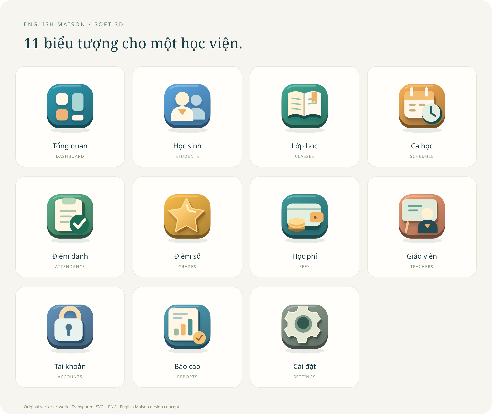
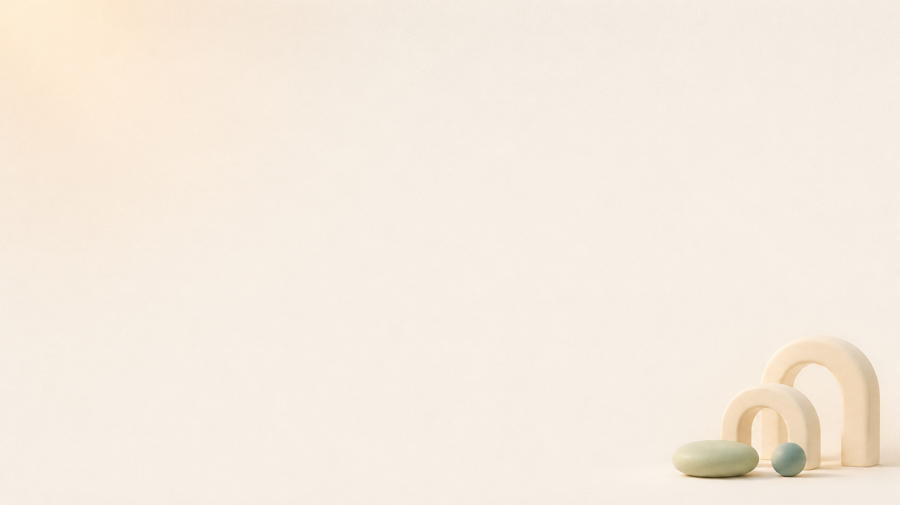

# English Maison — Bộ nút, biểu tượng 3D và ảnh nền

Bộ tài nguyên thiết kế độc lập. Chưa tích hợp vào app; không thay đổi chức năng, dữ liệu, cấu hình Cloudflare hoặc dependency ứng dụng.



## Xem bộ nút

Tải thư mục này và mở **index.html** bằng Chrome/Edge, giữ nguyên các thư mục con. Trang xem trước dùng font và hình ảnh có sẵn trong thư mục, không gọi API, không cần đăng nhập hoặc Internet. Có thể di chuột, nhấn nút và dùng phím Tab để thử các trạng thái.

## Nội dung

| Đường dẫn | Nội dung |
|---|---|
| `buttons/svg/` | 10 nút có nhãn tiếng Việt, thêm 3 biến thể hover/pressed/disabled của nút Xác nhận; SVG 240 × 76 |
| `buttons/png/` | Cùng bộ nút, PNG nền trong suốt 960 × 304 |
| `icons/svg/` | 11 biểu tượng menu SVG, viewBox 128 × 128 |
| `icons/png/` | 11 biểu tượng menu PNG nền trong suốt 512 × 512 |
| `icons/action/` | Glyph cho thêm, lưu, tìm, sửa, tải xuống, in, xóa, xác nhận, lịch, khóa, menu… |
| `icons/menu-icons-sheet.svg` | Bảng tổng hợp biểu tượng dạng vector |
| `icons/menu-icons-sheet.png` | Bảng tổng hợp PNG 2400 × 2020 |
| `buttons-3d.css` | CSS mẫu dùng lớp `em-btn`, có hover/nhấn/focus/vô hiệu hóa và giảm chuyển động |
| `design-tokens.json` | Màu, font, bo góc, khoảng cách và chiều sâu |
| `backgrounds/academy-hero.png` | Nền đăng nhập: ngôi trường, sách và minh họa 3D; PNG 1672 × 941 |
| `backgrounds/app-canvas.png` | Nền app: màu kem và khối trang trí nhẹ ở góc; PNG 1672 × 941 |
| `fonts/` | Noto Sans hỗ trợ tiếng Việt và giấy phép đi kèm |

10 nút: Thêm học sinh, Lưu thay đổi, Xem báo cáo, Xuất Excel, In / Lưu PDF, Chỉnh sửa, Hủy, Xóa, Đăng nhập, Xác nhận.

11 mục menu: Tổng quan, Học sinh, Lớp học, Ca học, Điểm danh, Điểm số, Học phí, Giáo viên, Tài khoản, Báo cáo, Cài đặt.

## Ví dụ sử dụng sau khi quyết định tích hợp

```html
<link rel="stylesheet" href="buttons-3d.css" />

<button class="em-btn" type="button">
  
  Thêm học sinh
</button>

<button class="em-btn em-btn--danger" type="button">
  
  Xóa
</button>

<button class="em-btn em-btn--secondary" type="button" disabled>
  Chưa khả dụng
</button>
```

Khi tích hợp thật, dùng CSS và biểu tượng SVG trong thành phần nút dùng chung để giữ chữ sắc nét, hỗ trợ trạng thái tải, vô hiệu hóa và bàn phím. PNG có nhãn phù hợp cho tài liệu/mẫu thiết kế. SVG có thể chỉnh sửa trong Figma, Illustrator hoặc Inkscape; đây là hình có hiệu ứng 3D, không phải mô hình Blender/GLB.

Các nút trên trang xem trước chỉ minh họa hình thức, không thực hiện lưu/xóa hoặc gửi dữ liệu. Thuộc tính `aria-disabled` là mô tả truy cập; với nút HTML hãy dùng `disabled` để chặn thao tác thực tế. Chưa áp dụng stylesheet này vào app đang chạy.

## Ảnh nền

### Nền đăng nhập — Academy hero


Dùng cho trang đăng nhập hoặc banner chào mừng. Giữ chữ ở vùng trống bên trái; điều chỉnh vị trí ảnh theo kích thước màn hình để tránh che nội dung.

### Nền ứng dụng — App canvas



Nền kem nhẹ, chi tiết trang trí ở góc, dùng phía sau các thẻ và bảng dữ liệu. Giữ nền thẻ đủ đặc để chữ luôn dễ đọc. Hai ảnh được tạo riêng bằng công cụ sinh ảnh, đã đưa vào kho tài nguyên thiết kế; chưa áp dụng lên app.
