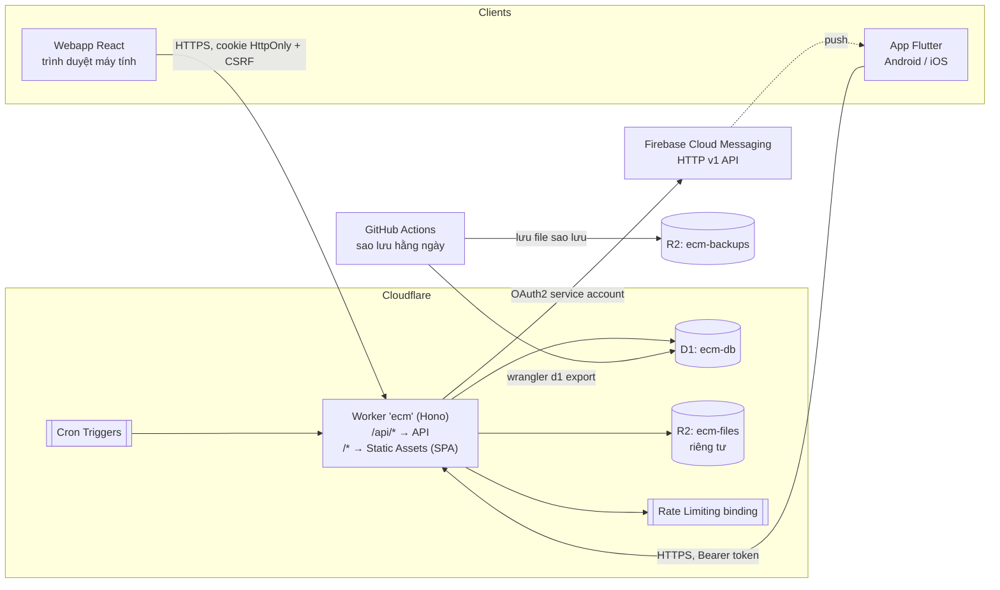
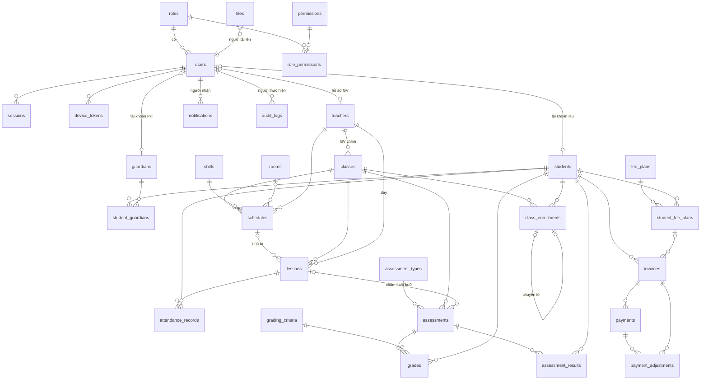
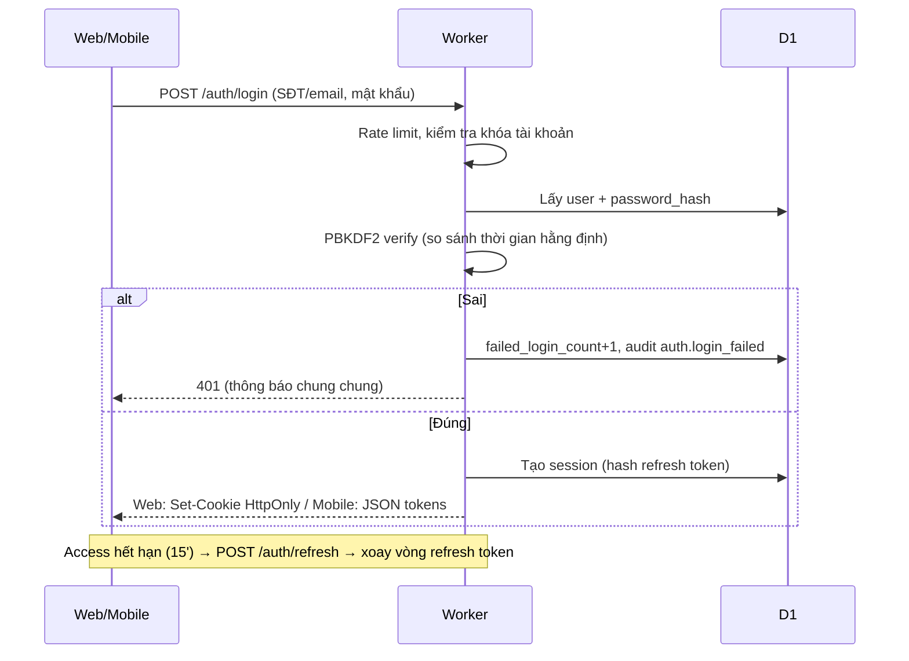
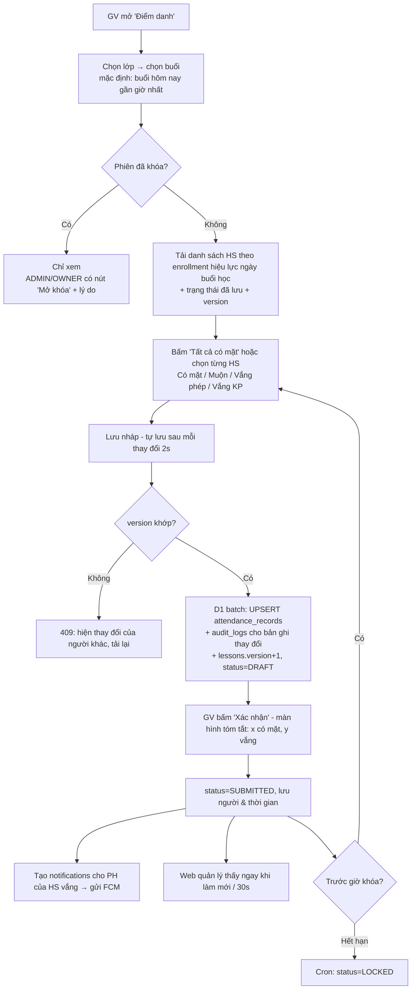
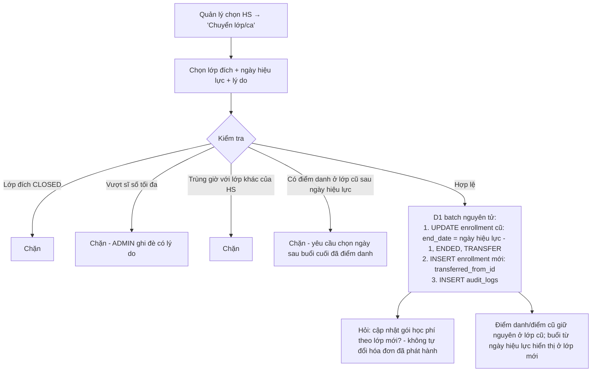
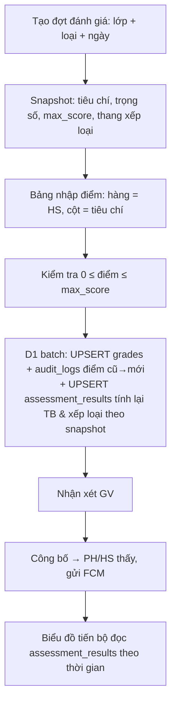
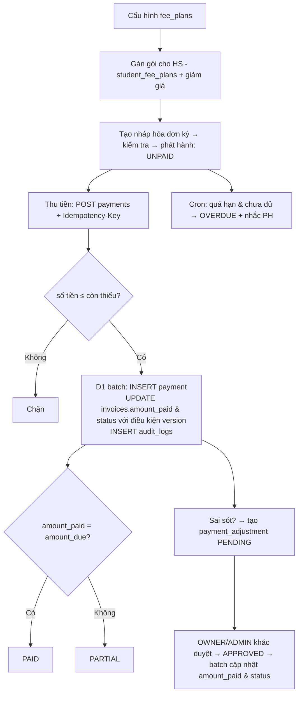
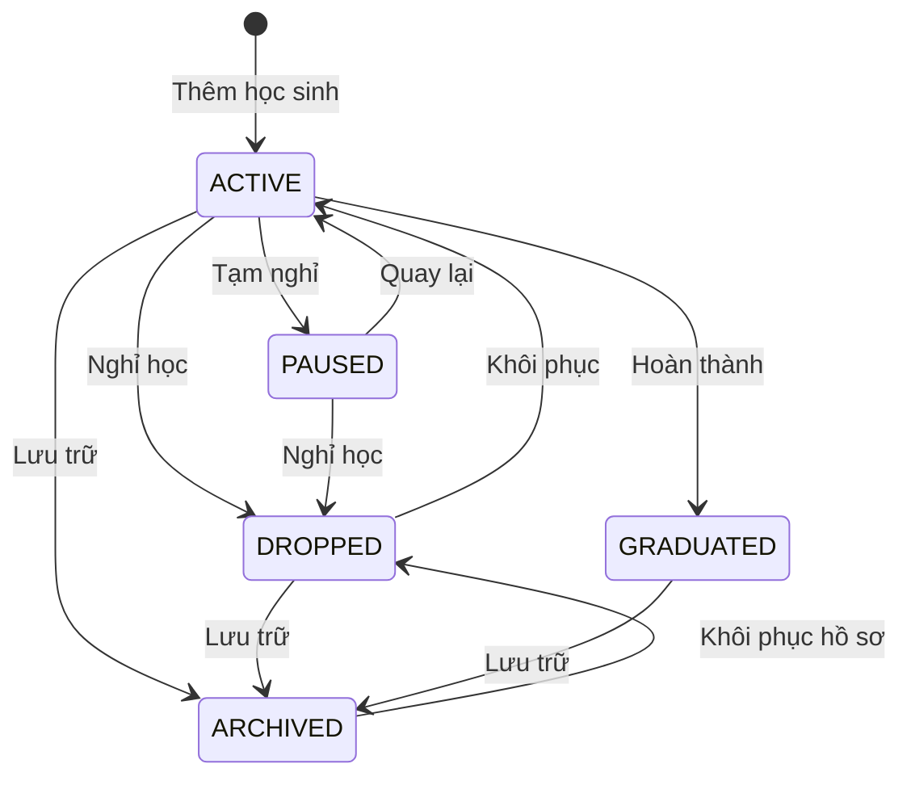

# HỆ THỐNG QUẢN LÝ LỚP HỌC TIẾNG ANH — TÀI LIỆU THIẾT KẾ GIAI ĐOẠN 1

> Trạng thái: **ĐÃ PHÊ DUYỆT** (12/11/2026) — chủ dự án đồng ý toàn bộ phương án đề xuất Q1–Q15, **ngoại trừ Q12: chọn gói Cloudflare Workers Free**; yêu cầu build cả Android và iOS.
> Xem "Phụ lục C. Điều chỉnh do chọn gói Free" ở cuối tài liệu.
> Phiên bản: 0.1 · Ngày: 12/11/2026 · Quy mô mục tiêu: ~200 học sinh, ~10 giáo viên, ~15–25 lớp.
> Ngôn ngữ: Tiếng Việt · Tiền tệ: VND · Múi giờ: Asia/Ho_Chi_Minh (UTC+7, không có giờ mùa hè).

Mục lục
0. Các điểm cần chủ dự án quyết định (đọc trước)
1. Phân tích nghiệp vụ
2. Kiến trúc hệ thống
3. Sơ đồ ERD
4. Danh sách bảng và trường
5. Danh sách API
6. Sơ đồ luồng nghiệp vụ
7. Thiết kế màn hình Webapp
8. Thiết kế màn hình Mobile
9. Kế hoạch phát triển theo giai đoạn
10. Tài nguyên Cloudflare cần tạo
Phụ lục A. Bốn lưu ý kỹ thuật (D1, Workers, R2, Flutter iOS)
Phụ lục B. Sao lưu, phục hồi, mất quyền quản trị

---

## 0. CÁC ĐIỂM CẦN CHỦ DỰ ÁN QUYẾT ĐỊNH

Theo nguyên tắc "không tự suy diễn nghiệp vụ quan trọng", các điểm sau chưa rõ trong yêu cầu. Mỗi điểm có **phương án đề xuất** (được dùng trong tài liệu này nếu chủ dự án đồng ý).

| # | Vấn đề | Phương án đề xuất | Phương án khác |
|---|---|---|---|
| Q1 | **"Ca học" gắn với lớp hay với học sinh?** Hồ sơ học sinh có cả "Lớp" và "Ca". | Ca thuộc **lịch của lớp**. Mỗi lớp có lịch cố định (VD: T2-T4-T6, Ca 2). Học sinh thuộc lớp ⇒ ca suy ra từ lớp. **"Chuyển ca" = chuyển sang lớp cùng trình độ học ở ca khác**, lưu lịch sử như chuyển lớp. | Một lớp có nhiều ca, học sinh chọn ca trong lớp (phức tạp hơn, điểm danh khó hơn). |
| Q2 | Một học sinh có thể học **nhiều lớp cùng lúc** không? (VD: lớp chính + lớp luyện thi) | **Cho phép**, mỗi lớp là một ghi danh (enrollment) riêng. Ràng buộc: không được trùng giờ. | Chỉ 1 lớp đang học tại một thời điểm. |
| Q3 | Vai trò **"Chủ lớp"** nghĩa là gì? | **Chủ cơ sở/chủ lớp học** (người sở hữu): xem toàn bộ, duyệt điều chỉnh tài chính, nhưng không quản lý cấu hình hệ thống & tài khoản quản trị. | Giáo viên chủ nhiệm một lớp (quyền giáo viên + sửa hồ sơ học sinh lớp mình). |
| Q4 | Có **quản lý phòng học** không? | **Có, dạng đơn giản** (bảng `rooms`: tên, sức chứa) để kiểm tra trùng phòng. Có thể để trống. | Không quản lý phòng. |
| Q5 | **Khóa phiên điểm danh** khi nào? | Giáo viên sửa tự do đến **23:59 cùng ngày** buổi học; sau đó tự khóa. Quản trị/Chủ lớp mở khóa có ghi lý do. | Khóa ngay khi giáo viên bấm "Xác nhận"; hoặc khóa sau N giờ (cấu hình). |
| Q6 | **Học phí theo số buổi** tính trên buổi nào? | Theo **gói buổi trả trước** (VD: 12 buổi = 1.800.000đ); hệ thống trừ buổi khi học sinh **có mặt / đi muộn / vắng không phép**; vắng có phép không trừ. Tỷ lệ trừ cấu hình được. | Tính theo số buổi lớp diễn ra trong tháng, bất kể đi học hay không. |
| Q7 | Hóa đơn tháng **tự động tạo** hay tạo tay? | **Bán tự động**: quản trị bấm "Tạo hóa đơn kỳ tháng MM/YYYY" → hệ thống tạo nháp cho mọi học sinh đang học theo gói học phí → kiểm tra → phát hành. | Cron tự tạo ngày 1 hàng tháng. |
| Q8 | Chấm điểm khi **thiếu tiêu chí** (VD: buổi học không chấm Speaking)? | Điểm trung bình chỉ tính trên các tiêu chí **có điểm**, chia lại theo tổng trọng số của các tiêu chí đó. | Tiêu chí thiếu tính 0 điểm. |
| Q9 | Mức "Xếp loại 5 – dưới 6.5: Trung bình". Biên được hiểu là `≥5 và <6.5`; tương tự cho các mức khác. Làm tròn điểm trung bình **1 chữ số thập phân** trước khi xếp loại? | Làm tròn **2 chữ số**, xếp loại trên giá trị đã làm tròn. | Làm tròn 1 chữ số. |
| Q10 | Phụ huynh/học sinh **có dùng app** trong phiên bản 1 không? | **Có, chế độ chỉ xem** (lịch học, điểm danh, điểm, học phí của con) trong cùng app Flutter, giao diện rút gọn theo vai trò. | Phiên bản 1 chỉ cho nội bộ (admin, giáo viên). |
| Q11 | Thanh toán **online** (VNPay/MoMo/QR)? | **Không** trong v1. Ghi nhận thủ công: tiền mặt / chuyển khoản / khác. Có thể hiển thị mã VietQR tĩnh để phụ huynh chuyển khoản. | Tích hợp cổng thanh toán (ngoài phạm vi). |
| Q12 | **Gói Cloudflare**: Free hay Workers Paid (5 USD/tháng)? | **Workers Paid** — giới hạn CPU 30s/request (Free chỉ 10ms, không đủ cho băm mật khẩu PBKDF2 và xuất báo cáo), D1 Time Travel 30 ngày. | Free (rủi ro lỗi CPU khi đăng nhập, sao lưu Time Travel chỉ 7 ngày). |
| Q13 | Đăng nhập bằng gì? | **Số điện thoại hoặc email + mật khẩu**. Phụ huynh đăng nhập bằng SĐT. Không dùng OTP SMS trong v1 (tốn phí). | Thêm đăng nhập Google; OTP SMS/Zalo. |
| Q14 | Có cần **phòng ban/cơ sở thứ 2** không? | **Không**. Một cơ sở duy nhất (không multi-tenant). | Thiết kế `branch_id` sẵn. |
| Q15 | Thời hạn lưu dữ liệu học sinh đã nghỉ? Yêu cầu theo Nghị định 13/2023/NĐ-CP về bảo vệ dữ liệu cá nhân. | Lưu vô thời hạn ở trạng thái "Đã nghỉ"; có chức năng **ẩn danh hóa** (xóa SĐT/địa chỉ/ảnh) theo yêu cầu, giữ lại số liệu tài chính. Cần mẫu đồng ý của phụ huynh khi chụp ảnh. | Tự động ẩn danh sau N năm. |

---

## 1. PHÂN TÍCH NGHIỆP VỤ

### 1.1. Các tác nhân (vai trò)

| Vai trò | Mô tả | Phạm vi dữ liệu |
|---|---|---|
| **Quản trị viên (ADMIN)** | Vận hành hệ thống | Toàn bộ; quản lý tài khoản, cấu hình, xem nhật ký |
| **Chủ lớp (OWNER)** | Chủ cơ sở (theo Q3) | Toàn bộ dữ liệu nghiệp vụ; duyệt hoàn tiền/điều chỉnh; không sửa cấu hình bảo mật |
| **Giáo viên (TEACHER)** | Dạy lớp | Chỉ các lớp được phân công (và học sinh trong các lớp đó); điểm danh, chấm điểm, nhận xét. **Không xem học phí** |
| **Phụ huynh (GUARDIAN)** | Theo dõi con | Chỉ học sinh được liên kết trong `student_guardians`; chỉ đọc |
| **Học sinh (STUDENT)** | Theo dõi bản thân | Chỉ hồ sơ của mình, nếu được cấp tài khoản; chỉ đọc |

### 1.2. Ma trận quyền chính (C=tạo, R=xem, U=sửa, D=xóa mềm, *=giới hạn phạm vi)

| Chức năng | ADMIN | OWNER | TEACHER | GUARDIAN | STUDENT |
|---|---|---|---|---|---|
| Dashboard tổng | R | R | R* (lớp mình, không có học phí) | – | – |
| Học sinh | CRUD | CRUD | R* | R* (con) | R* (mình) |
| Chuyển lớp / tạm nghỉ / nghỉ | ✓ | ✓ | – | – | – |
| Lớp học, ca học, lịch | CRUD | CRUD | R* | R* | R* |
| Điểm danh | CRUD + mở khóa | CRUD + mở khóa | CRU* (trước khi khóa) | R* | R* |
| Chấm điểm, nhận xét | CRUD | CRUD | CRU* | R* (đã công bố) | R* (đã công bố) |
| Tiêu chí, trọng số, thang xếp loại | CRUD | R | R | – | – |
| Học phí: hóa đơn, thu tiền | CRUD | CRUD | – | R* | – |
| Hoàn tiền / điều chỉnh | Tạo | Tạo + Duyệt | – | – | – |
| Giáo viên & tài khoản | CRUD | R + tạo GV/PH | Sửa hồ sơ mình | Sửa mật khẩu | Sửa mật khẩu |
| Báo cáo | ✓ | ✓ | ✓* (điểm danh, điểm lớp mình) | – | – |
| Cài đặt hệ thống, nhật ký | ✓ | R nhật ký | – | – | – |

### 1.3. Quy tắc nghiệp vụ theo module

**M01 – Dashboard**
- Mọi số liệu truy vấn trực tiếp từ D1 (không cache nghiệp vụ). Có thể cache HTTP ngắn 30–60s phía client (TanStack Query `staleTime`) — không phải dữ liệu giả.
- "Đang học" = trạng thái `ACTIVE`. "Lớp đang hoạt động" = lớp `OPEN`. "Ca học hôm nay" = số `lessons` có `lesson_date = hôm nay (UTC+7)` và không bị hủy.
- "Có mặt hôm nay" = số bản ghi `PRESENT` + `LATE`; "Vắng" = `EXCUSED` + `UNEXCUSED`, trong các buổi hôm nay.
- "Học phí đã thu / chưa thu" trong tháng hiện tại (bộ lọc chọn tháng).
- "Học sinh cần theo dõi": (a) vắng ≥ 3 buổi trong 30 ngày, hoặc tỷ lệ chuyên cần < 80%; (b) điểm TB kỳ gần nhất < 5; (c) hóa đơn quá hạn; (d) được đánh dấu thủ công `needs_attention`. Ngưỡng cấu hình trong `system_settings`.
- Biểu đồ: sĩ số theo tháng (12 tháng), chuyên cần theo tuần, phân bố xếp loại, doanh thu theo tháng.

**M02 – Học sinh**
- Mã tự động: `HS` + 5 chữ số theo id (VD `HS00042`), duy nhất, không tái sử dụng.
- Trạng thái: `ACTIVE` (đang học), `PAUSED` (tạm nghỉ, có ngày dự kiến quay lại), `DROPPED` (nghỉ học), `GRADUATED` (hoàn thành), `ARCHIVED` (đã lưu trữ – xóa mềm).
- Chuyển trạng thái hợp lệ: ACTIVE↔PAUSED, ACTIVE/PAUSED→DROPPED, DROPPED→ACTIVE (khôi phục), *→ARCHIVED, ARCHIVED→trạng thái trước (khôi phục).
- Tạm nghỉ/nghỉ học: đóng các enrollment đang mở (`end_date`, `end_reason`), không xóa điểm danh/điểm/hóa đơn. Hóa đơn chưa thanh toán vẫn giữ — hỏi người dùng có hủy kỳ tương lai không.
- **Không xóa vĩnh viễn** học sinh có điểm danh, điểm hoặc giao dịch. Học sinh tạo nhầm (chưa có dữ liệu liên quan) cho phép xóa cứng bởi ADMIN, có ghi nhật ký.
- Kiểm tra trùng: cảnh báo (không chặn) khi trùng họ tên + ngày sinh, hoặc trùng SĐT phụ huynh.
- "Trình độ" là danh mục cấu hình (VD: Starters, Movers, Flyers, KET, PET, IELTS…).
- Xuất Excel theo bộ lọc hiện tại.

**M03 – Ca học**
- `shifts` = khung giờ mẫu (Ca 1 14:00–15:30…), có thể sửa; ca mới phải có `start < end`.
- `schedules` = lịch lặp của một lớp: lớp + ca + thứ trong tuần + giáo viên + phòng + hiệu lực từ/đến.
- Kiểm tra xung đột khi tạo/sửa lịch: cùng thứ, khoảng giờ giao nhau, hiệu lực giao nhau và (cùng giáo viên **hoặc** cùng phòng) ⇒ **chặn** với thông báo rõ lớp bị trùng.
- Sửa giờ ca đang dùng: chỉ áp dụng cho buổi học **chưa diễn ra**; buổi đã diễn ra giữ giờ cũ (vì `lessons` lưu giờ riêng).
- Sĩ số tối đa đặt ở **lớp** (`classes.max_students`); thêm học sinh vượt sĩ số ⇒ chặn, ADMIN có thể ghi đè có lý do.
- Xem lịch: ngày / tuần / tháng, lọc theo giáo viên, phòng, lớp.

**M04 – Lớp học**
- Mã lớp duy nhất do người dùng nhập (VD `MOV-2611-A`), tên lớp, trình độ, giáo viên chính, sĩ số tối đa, ngày bắt đầu/kết thúc, trạng thái `PLANNED`/`OPEN`/`CLOSED`.
- **Buổi học (lessons)** được sinh từ lịch: khi mở lớp hoặc sửa lịch, hệ thống sinh buổi cho 8 tuần tới; Cron hàng tuần sinh tiếp. Có thể thêm buổi bù, hủy buổi (nghỉ lễ) — buổi hủy không tính chuyên cần/học phí.
- **Ghi danh (class_enrollments)**: mỗi lần vào lớp là một bản ghi có `start_date`, `end_date`. Chuyển lớp = **đóng** enrollment cũ (`end_date = ngày chuyển - 1`, `end_reason=TRANSFER`) + **tạo** enrollment mới (`transferred_from_id`) trong **một batch nguyên tử**.
- Danh sách học sinh của một buổi = enrollment có `start_date ≤ lesson_date ≤ coalesce(end_date, ∞)` ⇒ chuyển lớp không làm sai điểm danh cũ.
- Đóng lớp: chặn nếu còn phiên điểm danh chưa xác nhận trong quá khứ; tự đóng các enrollment còn mở; hủy buổi học tương lai. Mở lại lớp được phép (ghi nhật ký).
- Lịch sử sĩ số: suy ra từ enrollments (sĩ số tại ngày X), hiển thị biểu đồ + danh sách vào/ra.

**M05 – Điểm danh (ưu tiên cao nhất)**
- Mỗi `lesson` là một phiên điểm danh. Trạng thái phiên: `NOT_STARTED` → `DRAFT` (đã lưu tạm) → `SUBMITTED` (đã xác nhận) → `LOCKED` (đã khóa, theo Q5).
- Trạng thái học sinh: `PRESENT` (Có mặt), `EXCUSED` (Vắng có phép), `UNEXCUSED` (Vắng không phép), `LATE` (Đi muộn, có thể ghi số phút). Ghi chú tùy chọn.
- **Duy nhất**: `UNIQUE(lesson_id, student_id)`. Lưu dùng `INSERT … ON CONFLICT DO UPDATE` ⇒ gửi lại nhiều lần (mạng chập chờn) vẫn không trùng (idempotent).
- Điểm danh hàng loạt: "Tất cả có mặt" rồi sửa ngoại lệ.
- Mỗi thay đổi lưu: `marked_by`, `marked_at`; mỗi lần sửa sau lần đầu ghi `audit_logs` (giá trị cũ → mới, người, thời gian, thiết bị).
- Chống ghi đè đồng thời: phiên có cột `version`; khi lưu gửi kèm `version` đã đọc; khác ⇒ 409 "Phiên đã được người khác cập nhật, tải lại".
- Giáo viên chỉ điểm danh buổi của lớp mình được phân công, trong khoảng từ 30 phút trước giờ học đến khi khóa. Không cho điểm danh buổi tương lai (trừ ADMIN).
- Thống kê tự động (theo học sinh, theo lớp, theo khoảng thời gian): số buổi đã diễn ra trong thời gian ghi danh, có mặt, vắng (có phép / không phép), đi muộn, **Tỷ lệ chuyên cần = (Có mặt + Đi muộn) / Số buổi đã điểm danh × 100%** (cần xác nhận công thức).
- Khi xác nhận: gửi FCM cho phụ huynh của học sinh vắng (nếu bật).

**M06 – Chấm điểm và đánh giá**
- `grading_criteria`: Listening, Speaking, Reading, Writing, Homework, Attitude — mỗi tiêu chí có `weight` (mặc định 1) và `max_score` (mặc định 10). ADMIN sửa được.
- `assessment_types`: Theo buổi, Định kỳ, Kiểm tra tháng, Cuối khóa — mỗi loại chọn tiêu chí áp dụng.
- `assessments` = một đợt đánh giá của một lớp (VD: "Kiểm tra tháng 11/2026"). Khi tạo, **chụp lại (snapshot)** cấu hình tiêu chí + trọng số + thang điểm + thang xếp loại vào cột JSON ⇒ đổi cấu hình sau này **không làm thay đổi kết quả cũ**.
- `grades` = điểm từng tiêu chí của từng học sinh trong một đợt, `UNIQUE(assessment_id, student_id, criterion_id)`. Mọi lần sửa điểm ghi `audit_logs`.
- Điểm trung bình (thang 10) = Σ( score/max_score × 10 × weight ) / Σ weight, trên các tiêu chí có điểm (Q8).
- Xếp loại mặc định: ≥9 Xuất sắc; ≥8 Giỏi; ≥6.5 Khá; ≥5 Trung bình; <5 Cần cải thiện. ADMIN đổi được (lưu `system_settings.grade_bands`, có phiên bản).
- `assessment_results`: điểm TB đã tính, xếp loại, nhận xét giáo viên, trạng thái công bố (phụ huynh chỉ thấy khi `published`).
- Biểu đồ tiến bộ: điểm TB + từng kỹ năng theo thời gian của một học sinh.

**M07 – Học phí**
- Tiền lưu **số nguyên VND** (INTEGER), không dùng số thực.
- `fee_plans`: tên, loại `MONTHLY` / `COURSE` / `PER_SESSION`, đơn giá, số buổi (với gói buổi), áp dụng cho trình độ/lớp.
- `student_fee_plans`: gói của từng học sinh + giảm giá (số tiền hoặc %), hiệu lực từ/đến ⇒ "cấu hình từng học sinh".
- `invoices` (hóa đơn/kỳ thu): mã `HD-YYYYMM-0001`, học sinh, kỳ (`2026-11` hoặc tên khóa), số tiền gốc, giảm trừ, **phải nộp**, **đã nộp** (tính từ payments – adjustments), hạn nộp, trạng thái.
- Trạng thái hóa đơn: `UNPAID` / `PARTIAL` / `PAID` / `OVERDUE` (UNPAID/PARTIAL và đã quá hạn) / `CANCELLED`. Quá hạn được tính khi đọc + cron hàng ngày cập nhật để gửi nhắc.
- `payments` (giao dịch thu): mã `PT-YYYYMMDD-0001`, số tiền > 0, phương thức `CASH`/`BANK_TRANSFER`/`OTHER`, mã tham chiếu chuyển khoản, người thu, thời điểm. **Bất biến sau khi ghi** — API không có PUT/DELETE.
- `payment_adjustments`: `REFUND` (hoàn tiền), `CORRECTION` (điều chỉnh sai sót, âm/dương), `VOID` (hủy giao dịch nhập nhầm = bút toán đảo toàn bộ). Bắt buộc lý do; trạng thái `PENDING` → `APPROVED`/`REJECTED` bởi OWNER/ADMIN (người tạo không tự duyệt nếu có ≥ 2 tài khoản quản lý).
- Thu tiền vượt số còn thiếu ⇒ chặn (hoặc ghi "tiền thừa" — cần quyết định, đề xuất: chặn).
- Mọi thao tác tài chính ghi `audit_logs`. Có phiếu thu (in/PDF).
- Gói buổi: số buổi còn lại = buổi đã mua − buổi đã trừ (theo Q6); cảnh báo khi còn ≤ 2 buổi.
- Nhắc học phí: cron gửi FCM cho phụ huynh trước hạn 3 ngày và khi quá hạn.

**M08 – Giáo viên và tài khoản**
- `teachers`: hồ sơ giáo viên (liên kết 1–1 với `users`), trạng thái làm việc.
- Tài khoản do ADMIN/OWNER tạo, mật khẩu tạm, bắt buộc đổi ở lần đăng nhập đầu.
- Khóa/mở tài khoản, đặt lại mật khẩu (sinh mật khẩu tạm), thu hồi mọi phiên đăng nhập.
- Không cho tự đăng ký.

**M09 – Báo cáo**
- 10 báo cáo theo yêu cầu, bộ lọc: khoảng ngày, tháng, lớp, học sinh.
- API trả JSON; **file Excel/PDF được tạo ở trình duyệt** (thư viện `exceljs` và in PDF bằng `@react-pdf/renderer` hoặc trang in CSS) ⇒ không tốn CPU Worker. Với 200 học sinh, dữ liệu nhỏ.

**Thông báo (FCM)**: lịch học (nhắc trước 1 giờ – tùy chọn), học sinh vắng, kết quả học tập được công bố, nhắc học phí. Lưu bảng `notifications` để xem lại trong app (hộp thư), kể cả khi push thất bại.

### 1.4. Yêu cầu phi chức năng
- Thời gian phản hồi API p95 < 300ms; trang web tải lần đầu < 2s trên 4G.
- Đồng bộ: dữ liệu ghi trực tiếp vào D1 (nguồn sự thật duy nhất). Web tự làm mới khi quay lại tab + định kỳ 30s ở màn hình điểm danh/dashboard; mobile kéo để làm mới + nhận FCM "data message" để làm mới. **Không cần websocket/Durable Objects** cho quy mô này.
- Không hỗ trợ offline đầy đủ trong v1; khi mất mạng ở màn hình điểm danh, app giữ lựa chọn trong bộ nhớ và cho bấm "Thử lại" (không mất dữ liệu đã chọn).
- Truy cập được trên Chrome/Edge/Safari mới; Android 8+; iOS 14+.

---

## 2. KIẾN TRÚC HỆ THỐNG

### 2.1. Tổng quan



**Quyết định kiến trúc chính**

| Quyết định | Lý do | Ảnh hưởng |
|---|---|---|
| **Một Worker duy nhất** phục vụ cả API (`/api/*`) và SPA (Static Assets) | Cùng origin ⇒ không cần CORS cho web, cookie `SameSite=Strict` hoạt động, một lần deploy, chi phí thấp | Cấu trúc thư mục giữ `apps/web` và `workers/` tách biệt; `wrangler.jsonc` trỏ `assets.directory` tới `apps/web/dist` |
| **REST + Hono + Zod**, schema Zod đặt ở `packages/shared` | Web dùng lại schema để validate form; Flutter có tài liệu API rõ ràng | Flutter tự viết model Dart (theo `docs/API.md`) |
| **Drizzle ORM** cho D1 | Truy vấn có tham số, an toàn kiểu, sinh migration SQL | Mọi migration là file `.sql` được review thủ công |
| **D1 `batch()`** cho nghiệp vụ cần toàn vẹn | D1 không hỗ trợ `BEGIN/COMMIT` tương tác; `batch()` chạy nguyên tử (all-or-nothing) | Thiết kế mỗi nghiệp vụ thành một batch câu lệnh + ràng buộc UNIQUE/CHECK + điều kiện `WHERE` |
| **Polling + FCM data message** thay vì realtime socket | Đủ cho 200 học sinh, đơn giản, rẻ | Độ trễ đồng bộ web ≤ 30s (hoặc tức thì khi đổi màn hình) |
| **File R2 chỉ truy cập qua Worker** | Kiểm tra quyền mỗi lần tải; bucket không bật public | Ảnh được phục vụ qua `/api/files/:id/content`, cache riêng tư ngắn |
| **Xuất Excel/PDF ở client** | Tránh giới hạn CPU/bộ nhớ Worker (128MB) | Cần thư viện JS phía web |

### 2.2. Xác thực & phiên đăng nhập

- **Băm mật khẩu**: PBKDF2-HMAC-SHA256 qua WebCrypto native, 100.000 vòng (mức tối đa Workers hỗ trợ), salt 16 byte ngẫu nhiên, lưu dạng `pbkdf2$100000$<salt>$<hash>` (cho phép nâng cấp thuật toán sau). Không dùng bcrypt/argon2 bằng JS thuần vì tốn CPU.
- **Access token**: JWT HS256, hạn **15 phút**, chứa `sub`, `role`, `sid`. Khóa ký là Secret `JWT_SECRET`.
- **Refresh token**: chuỗi ngẫu nhiên 32 byte, lưu **băm SHA-256** trong bảng `sessions`, hạn 30 ngày (mobile) / 7 ngày (web), **xoay vòng** mỗi lần làm mới; phát hiện dùng lại token cũ ⇒ thu hồi toàn bộ phiên đó.
- **Web**: `access_token` và `refresh_token` trong cookie `HttpOnly; Secure; SameSite=Strict; Path=/api` (refresh: `Path=/api/auth`). **Chống CSRF**: cookie `csrf_token` (không HttpOnly) + header `X-CSRF-Token` bắt buộc cho mọi request thay đổi dữ liệu (double-submit) + kiểm tra header `Origin`.
- **Mobile**: `Authorization: Bearer <access>`; refresh token lưu `flutter_secure_storage` (Keychain iOS / Keystore Android).
- **Chống dò mật khẩu**: Cloudflare Rate Limiting binding (5 lần/phút/IP+tài khoản) + khóa tài khoản tạm 15 phút sau 10 lần sai.
- **Phân quyền**: middleware `requireAuth` → `requirePermission('attendance.write')` → kiểm tra phạm vi dữ liệu trong service (VD `assertTeacherOwnsClass`). Phạm vi luôn được kiểm tra ở server; không tin vào client.

### 2.3. Phân lớp mã nguồn Backend

```
request → Hono router (routes/) → middleware (auth, csrf, rbac, rate-limit, error)
        → validators (Zod) → services (nghiệp vụ, kiểm tra phạm vi)
        → repositories (Drizzle/D1, batch) → D1 / R2
        → audit service (ghi audit_logs trong cùng batch)
```

### 2.4. Cấu trúc Monorepo (pnpm workspaces)

```
english-class-management/
├── apps/
│   ├── web/                    React + Vite + TS + Tailwind + shadcn/ui
│   │   └── src/{components,pages,layouts,services,hooks,lib,routes}
│   └── mobile/                 Flutter
│       └── lib/{screens,widgets,services,models,providers,core}
├── workers/                    Hono API + phục vụ static assets
│   ├── src/{routes,services,middleware,repositories,validators,db,cron,index.ts}
│   ├── migrations/             0001_init.sql, 0002_seed_roles.sql …
│   ├── test/                   Vitest + @cloudflare/vitest-pool-workers
│   └── wrangler.jsonc
├── packages/shared/            Zod schema, enum, hằng số, hàm tính điểm/học phí dùng chung
├── scripts/                    tạo admin đầu tiên, sao lưu, khôi phục
├── docs/                       ARCHITECTURE, DATABASE, API, DEPLOYMENT, USER_GUIDE, TEST_REPORT, BACKUP
├── .github/workflows/          CI (lint, typecheck, test) + backup hằng ngày
├── .env.example
├── README.md
└── package.json
```

**Thư viện Flutter đề xuất**: `dio` (HTTP + interceptor làm mới token), `flutter_riverpod` (state), `go_router`, `flutter_secure_storage`, `firebase_core` + `firebase_messaging`, `fl_chart`, `intl` (định dạng VND, ngày tiếng Việt), `image_picker`.

---

## 3. SƠ ĐỒ ERD

> Chỉ thể hiện khóa và trường chính; danh sách trường đầy đủ ở mục 4.



---

## 4. DANH SÁCH BẢNG VÀ TRƯỜNG

**Quy ước chung**
- Khóa chính `id INTEGER PRIMARY KEY AUTOINCREMENT` (nhỏ gọn, nhanh với SQLite). Các mã hiển thị (`student_code`, `invoice_code`…) là cột riêng `UNIQUE`.
- Thời điểm: `TEXT` ISO-8601 UTC (`2026-11-12T07:30:00.000Z`). Ngày nghiệp vụ: `TEXT 'YYYY-MM-DD'` theo giờ Việt Nam. Giờ: `TEXT 'HH:MM'`.
- Tiền: `INTEGER` VND. Boolean: `INTEGER 0/1`. Enum: `TEXT` + `CHECK(...)`.
- Mọi bảng nghiệp vụ có `created_at`, `updated_at`; bảng cần xóa mềm có `deleted_at`. Bảng được sửa đồng thời có `version INTEGER` (khóa lạc quan).
- `PRAGMA foreign_keys` được D1 bật mặc định; FK dùng `ON DELETE RESTRICT` (không xóa dây chuyền dữ liệu lịch sử).
- Các bảng **thêm** so với danh sách tối thiểu (có lý do): `role_permissions` (quan hệ N–N), `sessions` (refresh token), `device_tokens` (FCM), `shifts`, `rooms` (Q4), `student_fee_plans` (học phí riêng từng học sinh), `assessment_results` (điểm TB/nhận xét/công bố). Lịch sử sửa điểm danh và sửa điểm lưu trong `audit_logs` (không tạo bảng riêng).

### 4.1. Tài khoản & phân quyền

**roles**
| Trường | Kiểu | Ràng buộc / ghi chú |
|---|---|---|
| id | INTEGER | PK |
| code | TEXT | UNIQUE, `ADMIN`/`OWNER`/`TEACHER`/`GUARDIAN`/`STUDENT` |
| name | TEXT | Tên tiếng Việt |
| is_system | INTEGER | 1 = không được xóa |
| created_at, updated_at | TEXT | |

**permissions**: `id` PK, `code` UNIQUE (VD `students.read`, `students.write`, `attendance.write`, `attendance.unlock`, `grades.write`, `grading.config`, `fees.read`, `fees.write`, `fees.approve_adjustment`, `users.manage`, `settings.manage`, `reports.read`, `audit.read`), `description`, `created_at`.

**role_permissions**: `role_id` FK, `permission_id` FK, PK(`role_id`,`permission_id`).

**users**
| Trường | Kiểu | Ràng buộc / ghi chú |
|---|---|---|
| id | INTEGER | PK |
| role_id | INTEGER | FK roles, NOT NULL |
| full_name | TEXT | NOT NULL |
| email | TEXT | UNIQUE (cho phép NULL), lưu chữ thường |
| phone | TEXT | UNIQUE (cho phép NULL), chuẩn hóa `0xxxxxxxxx` |
| password_hash | TEXT | NOT NULL, `pbkdf2$…` |
| must_change_password | INTEGER | mặc định 1 |
| status | TEXT | `ACTIVE`/`LOCKED`/`DISABLED` |
| failed_login_count | INTEGER | |
| locked_until | TEXT | |
| last_login_at | TEXT | |
| avatar_file_id | INTEGER | FK files, NULL |
| created_at, updated_at, deleted_at | TEXT | |
CHECK: `email IS NOT NULL OR phone IS NOT NULL`. Index: `role_id`, `status`.

**sessions**: `id` PK, `user_id` FK, `refresh_token_hash` TEXT UNIQUE, `client` (`WEB`/`MOBILE`), `user_agent`, `ip`, `expires_at`, `revoked_at`, `replaced_by_id`, `created_at`, `last_used_at`. Index `user_id`.

**device_tokens**: `id` PK, `user_id` FK, `fcm_token` TEXT UNIQUE, `platform` (`ANDROID`/`IOS`), `created_at`, `last_seen_at`.

### 4.2. Học sinh & phụ huynh

**students**
| Trường | Kiểu | Ràng buộc / ghi chú |
|---|---|---|
| id | INTEGER | PK |
| student_code | TEXT | UNIQUE NOT NULL, `HS00001` |
| full_name | TEXT | NOT NULL |
| full_name_search | TEXT | bỏ dấu, chữ thường — để tìm kiếm tiếng Việt |
| date_of_birth | TEXT | |
| gender | TEXT | `MALE`/`FEMALE`/`OTHER` |
| address | TEXT | |
| school_name | TEXT | Trường đang học |
| school_grade | TEXT | Lớp tại trường (VD "5A") |
| start_date | TEXT | Ngày bắt đầu học, NOT NULL |
| english_level | TEXT | Mã trình độ (danh mục trong system_settings) |
| status | TEXT | `ACTIVE`/`PAUSED`/`DROPPED`/`GRADUATED`/`ARCHIVED` |
| status_before_archive | TEXT | để khôi phục |
| pause_until | TEXT | ngày dự kiến quay lại |
| needs_attention | INTEGER | đánh dấu theo dõi đặc biệt |
| attention_note | TEXT | |
| notes | TEXT | |
| photo_file_id | INTEGER | FK files |
| user_id | INTEGER | FK users, UNIQUE, NULL (tài khoản học sinh) |
| version | INTEGER | |
| created_by | INTEGER | FK users |
| created_at, updated_at, deleted_at | TEXT | |
Index: `status`, `full_name_search`, `english_level`.
> "Lớp tại trung tâm" và "Ca học" **không lưu trực tiếp** ở bảng này (tránh dữ liệu mâu thuẫn) — được suy ra từ `class_enrollments` đang hiệu lực + `schedules`.

**guardians**: `id` PK, `full_name` NOT NULL, `phone` NOT NULL (index), `relationship_default`, `email`, `user_id` FK UNIQUE NULL, `created_at`, `updated_at`, `deleted_at`.

**student_guardians**: `student_id` FK, `guardian_id` FK, `relationship` (`FATHER`/`MOTHER`/`OTHER`), `is_primary` INTEGER, `receive_notifications` INTEGER, `created_at`; PK(`student_id`,`guardian_id`).

### 4.3. Giáo viên, phòng, ca, lớp, lịch

**teachers**: `id` PK, `user_id` FK UNIQUE NOT NULL, `teacher_code` UNIQUE (`GV001`), `full_name`, `phone`, `email`, `specialty`, `status` (`ACTIVE`/`INACTIVE`), `hired_date`, `notes`, `created_at`, `updated_at`, `deleted_at`.

**rooms**: `id` PK, `name` UNIQUE, `capacity`, `is_active`, `created_at`, `updated_at`.

**shifts**: `id` PK, `name` (VD "Ca 1"), `start_time` 'HH:MM', `end_time`, `is_active`, `sort_order`, `created_at`, `updated_at`; CHECK `start_time < end_time`; UNIQUE(`name`).

**classes**
| Trường | Kiểu | Ràng buộc / ghi chú |
|---|---|---|
| id | INTEGER | PK |
| class_code | TEXT | UNIQUE NOT NULL |
| name | TEXT | NOT NULL |
| english_level | TEXT | |
| main_teacher_id | INTEGER | FK teachers |
| max_students | INTEGER | CHECK > 0 |
| start_date | TEXT | NOT NULL |
| end_date | TEXT | NULL, CHECK ≥ start_date |
| status | TEXT | `PLANNED`/`OPEN`/`CLOSED` |
| default_fee_plan_id | INTEGER | FK fee_plans, NULL |
| notes | TEXT | |
| version | INTEGER | |
| created_at, updated_at, closed_at, deleted_at | TEXT | |
Index: `status`, `main_teacher_id`.

**class_enrollments** (lịch sử xếp lớp / chuyển lớp)
| Trường | Kiểu | Ràng buộc / ghi chú |
|---|---|---|
| id | INTEGER | PK |
| student_id | INTEGER | FK students |
| class_id | INTEGER | FK classes |
| start_date | TEXT | NOT NULL |
| end_date | TEXT | NULL = đang học |
| status | TEXT | `ACTIVE`/`ENDED` |
| end_reason | TEXT | `TRANSFER`/`PAUSE`/`DROP`/`CLASS_CLOSED`/`COMPLETED` |
| transferred_from_id | INTEGER | FK class_enrollments, NULL |
| note | TEXT | lý do chuyển |
| created_by | INTEGER | FK users |
| created_at, updated_at | TEXT | |
Index: (`class_id`,`status`), (`student_id`,`status`). Partial UNIQUE: `UNIQUE(student_id, class_id) WHERE status='ACTIVE'`. CHECK `end_date IS NULL OR end_date >= start_date`.

**schedules** (lịch lặp)
| Trường | Kiểu | Ràng buộc / ghi chú |
|---|---|---|
| id | INTEGER | PK |
| class_id | INTEGER | FK classes |
| shift_id | INTEGER | FK shifts |
| weekday | INTEGER | 1=Thứ 2 … 7=Chủ nhật |
| teacher_id | INTEGER | FK teachers |
| room_id | INTEGER | FK rooms, NULL |
| effective_from | TEXT | NOT NULL |
| effective_to | TEXT | NULL |
| created_at, updated_at, deleted_at | TEXT | |
Index: (`teacher_id`,`weekday`), (`room_id`,`weekday`), `class_id`.

**lessons** (buổi học = phiên điểm danh)
| Trường | Kiểu | Ràng buộc / ghi chú |
|---|---|---|
| id | INTEGER | PK |
| class_id | INTEGER | FK classes |
| schedule_id | INTEGER | FK schedules, NULL (buổi bù) |
| lesson_date | TEXT | NOT NULL |
| start_time, end_time | TEXT | chép từ ca tại thời điểm sinh |
| teacher_id | INTEGER | FK teachers (GV dạy thực tế, có thể dạy thay) |
| room_id | INTEGER | FK rooms |
| status | TEXT | `SCHEDULED`/`COMPLETED`/`CANCELLED` |
| cancel_reason | TEXT | |
| topic | TEXT | nội dung bài học |
| attendance_status | TEXT | `NOT_STARTED`/`DRAFT`/`SUBMITTED`/`LOCKED` |
| attendance_submitted_by | INTEGER | FK users |
| attendance_submitted_at | TEXT | |
| attendance_locked_at | TEXT | |
| version | INTEGER | |
| created_at, updated_at | TEXT | |
UNIQUE(`class_id`,`lesson_date`,`start_time`). Index: `lesson_date`, (`teacher_id`,`lesson_date`).

### 4.4. Điểm danh

**attendance_records**
| Trường | Kiểu | Ràng buộc / ghi chú |
|---|---|---|
| id | INTEGER | PK |
| lesson_id | INTEGER | FK lessons |
| student_id | INTEGER | FK students |
| enrollment_id | INTEGER | FK class_enrollments (truy vết) |
| status | TEXT | `PRESENT`/`EXCUSED`/`UNEXCUSED`/`LATE` |
| late_minutes | INTEGER | NULL |
| note | TEXT | |
| marked_by | INTEGER | FK users |
| marked_at | TEXT | |
| updated_by | INTEGER | FK users |
| created_at, updated_at | TEXT | |
**UNIQUE(`lesson_id`,`student_id`)**. Index: (`student_id`,`lesson_id`).

### 4.5. Đánh giá & điểm

**grading_criteria**: `id` PK, `code` UNIQUE (`LISTENING`…), `name`, `weight` REAL CHECK > 0, `max_score` REAL CHECK > 0, `is_active`, `sort_order`, `created_at`, `updated_at`.

**assessment_types**: `id` PK, `code` UNIQUE (`LESSON`/`PERIODIC`/`MONTHLY`/`FINAL`), `name`, `criteria_ids` TEXT (JSON mảng tiêu chí áp dụng), `is_active`, `created_at`, `updated_at`.

**assessments** (đợt đánh giá)
| Trường | Kiểu | Ghi chú |
|---|---|---|
| id | INTEGER | PK |
| class_id | INTEGER | FK classes |
| assessment_type_id | INTEGER | FK assessment_types |
| lesson_id | INTEGER | FK lessons, NULL |
| title | TEXT | "Kiểm tra tháng 11/2026" |
| assessed_on | TEXT | ngày |
| config_snapshot | TEXT | JSON: tiêu chí + trọng số + thang điểm + thang xếp loại tại thời điểm tạo |
| status | TEXT | `DRAFT`/`PUBLISHED` |
| published_at | TEXT | |
| created_by | INTEGER | FK users |
| created_at, updated_at, deleted_at | TEXT | |
Index: (`class_id`,`assessed_on`).

**grades**: `id` PK, `assessment_id` FK, `student_id` FK, `criterion_id` FK, `score` REAL (CHECK 0 ≤ score ≤ max trong snapshot — kiểm tra ở service), `graded_by`, `graded_at`, `created_at`, `updated_at`; **UNIQUE(`assessment_id`,`student_id`,`criterion_id`)**; index (`student_id`).

**assessment_results**: `id` PK, `assessment_id` FK, `student_id` FK, `weighted_average` REAL, `classification` TEXT, `teacher_comment` TEXT, `computed_at`, `updated_by`, `created_at`, `updated_at`; UNIQUE(`assessment_id`,`student_id`). (Tính lại trong cùng batch mỗi khi điểm thay đổi.)

### 4.6. Học phí

**fee_plans**: `id` PK, `code` UNIQUE, `name`, `billing_type` (`MONTHLY`/`COURSE`/`PER_SESSION`), `amount` INTEGER (đơn giá gói), `session_count` INTEGER NULL (gói buổi / khóa), `english_level` NULL, `is_active`, `description`, `created_at`, `updated_at`.

**student_fee_plans**: `id` PK, `student_id` FK, `fee_plan_id` FK, `class_id` FK NULL, `custom_amount` INTEGER NULL, `discount_type` (`NONE`/`AMOUNT`/`PERCENT`), `discount_value` INTEGER, `discount_reason`, `effective_from`, `effective_to`, `created_by`, `created_at`, `updated_at`. Index (`student_id`).

**invoices**
| Trường | Kiểu | Ghi chú |
|---|---|---|
| id | INTEGER | PK |
| invoice_code | TEXT | UNIQUE `HD-202611-0001` |
| student_id | INTEGER | FK |
| student_fee_plan_id | INTEGER | FK, NULL |
| period_label | TEXT | `2026-11` / tên khóa / "Gói 12 buổi" |
| period_start, period_end | TEXT | |
| sessions_purchased | INTEGER | NULL (gói buổi) |
| gross_amount | INTEGER | ≥ 0 |
| discount_amount | INTEGER | ≥ 0 |
| amount_due | INTEGER | = gross − discount, CHECK ≥ 0 |
| amount_paid | INTEGER | tổng hợp, cập nhật trong cùng batch với payment/adjustment |
| due_date | TEXT | |
| status | TEXT | `DRAFT`/`UNPAID`/`PARTIAL`/`PAID`/`OVERDUE`/`CANCELLED` |
| issued_at, cancelled_at | TEXT | |
| cancel_reason | TEXT | |
| created_by | INTEGER | FK users |
| version | INTEGER | |
| created_at, updated_at | TEXT | |
UNIQUE(`student_id`,`student_fee_plan_id`,`period_label`) — chống tạo trùng kỳ. Index: `status`, `due_date`, `student_id`.

**payments** (bất biến)
| Trường | Kiểu | Ghi chú |
|---|---|---|
| id | INTEGER | PK |
| payment_code | TEXT | UNIQUE `PT-20261112-0001` |
| invoice_id | INTEGER | FK |
| student_id | INTEGER | FK (truy vấn nhanh) |
| amount | INTEGER | CHECK > 0 |
| method | TEXT | `CASH`/`BANK_TRANSFER`/`OTHER` |
| reference_no | TEXT | mã giao dịch ngân hàng |
| paid_at | TEXT | thời điểm nhận tiền |
| received_by | INTEGER | FK users |
| note | TEXT | |
| idempotency_key | TEXT | UNIQUE — chống bấm 2 lần tạo 2 giao dịch |
| created_at | TEXT | (không có updated_at) |
Index: `invoice_id`, `paid_at`.

**payment_adjustments**: `id` PK, `adjustment_code` UNIQUE (`DC-…`), `invoice_id` FK, `payment_id` FK NULL, `type` (`REFUND`/`CORRECTION`/`VOID`), `amount` INTEGER (âm = giảm số đã thu), `reason` NOT NULL, `status` (`PENDING`/`APPROVED`/`REJECTED`), `requested_by`, `requested_at`, `approved_by`, `approved_at`, `created_at`. Chỉ khi `APPROVED` mới cộng vào `invoices.amount_paid`.

### 4.7. Hệ thống

**notifications**: `id` PK, `user_id` FK (người nhận), `type` (`SCHEDULE`/`ABSENCE`/`RESULT`/`FEE_DUE`/`FEE_OVERDUE`/`SYSTEM`), `title`, `body`, `data` JSON, `student_id` NULL, `push_status` (`PENDING`/`SENT`/`FAILED`/`SKIPPED`), `read_at`, `created_at`. Index (`user_id`,`read_at`). UNIQUE(`user_id`,`type`,`dedupe_key`) để cron không gửi trùng.

**files**: `id` PK, `r2_key` UNIQUE (dạng `students/{id}/{uuid}.jpg`, không chứa tên người), `original_name`, `mime_type`, `size_bytes`, `category` (`STUDENT_PHOTO`/`AVATAR`/`DOCUMENT`/`ATTACHMENT`), `owner_type` + `owner_id` (đối tượng gắn), `visibility` (`STAFF`/`CLASS`/`OWNER_LINKED`), `uploaded_by`, `created_at`, `deleted_at`. Index (`owner_type`,`owner_id`).

**audit_logs** (chỉ thêm, không sửa/xóa qua API)
| Trường | Kiểu | Ghi chú |
|---|---|---|
| id | INTEGER | PK |
| actor_user_id | INTEGER | FK users, NULL (cron) |
| action | TEXT | `student.create`, `enrollment.transfer`, `attendance.update`, `grade.update`, `payment.create`, `adjustment.approve`, `auth.login_failed`… |
| entity_type | TEXT | |
| entity_id | INTEGER | |
| before_data | TEXT | JSON |
| after_data | TEXT | JSON |
| reason | TEXT | |
| ip, user_agent | TEXT | |
| request_id | TEXT | |
| created_at | TEXT | |
Index (`entity_type`,`entity_id`), (`actor_user_id`,`created_at`), `created_at`.

**system_settings**: `key` TEXT PK, `value` TEXT (JSON), `updated_by`, `updated_at`. Khóa mặc định: `center_name`, `english_levels`, `grade_bands` (thang xếp loại), `attendance_lock_policy`, `attention_thresholds`, `invoice_due_day`, `fee_reminder_days_before`, `per_session_deduct_rules`, `bank_qr_info`.

### 4.8. Index & migration
- Migration đánh số: `0001_init_schema.sql`, `0002_seed_roles_permissions.sql`, `0003_seed_defaults.sql` (tiêu chí, loại đánh giá, ca mẫu, cài đặt). **Không seed dữ liệu học sinh giả** vào môi trường production; dữ liệu demo chỉ có trong `seed.dev.sql` cho local.
- Quy trình: viết schema Drizzle → `drizzle-kit generate` → review SQL → `wrangler d1 migrations apply --local` → test → apply `--remote` (sau khi đã tạo bookmark Time Travel).

---

## 5. DANH SÁCH API

Tiền tố `/api/v1`. JSON UTF-8. Lỗi chuẩn: `{ "error": { "code": "ATTENDANCE_LOCKED", "message": "Phiên điểm danh đã khóa", "details": … } }`. Danh sách có phân trang `?page=&pageSize=` (tối đa 100) và trả `{ data, page, pageSize, total }`. Quyền ghi bên phải (* = giới hạn phạm vi).

### 5.1. Xác thực & tài khoản cá nhân
| Method | Endpoint | Mô tả | Quyền |
|---|---|---|---|
| POST | /auth/login | Đăng nhập (`identifier`, `password`, `client`) | Công khai, rate-limit |
| POST | /auth/refresh | Làm mới token (xoay vòng) | Có refresh token |
| POST | /auth/logout | Thu hồi phiên hiện tại | Đã đăng nhập |
| POST | /auth/logout-all | Thu hồi mọi phiên | Đã đăng nhập |
| GET | /auth/csrf | Cấp CSRF token (web) | Công khai |
| GET | /me | Thông tin người dùng + quyền + phạm vi | Đã đăng nhập |
| PATCH | /me | Sửa tên, SĐT, avatar | Đã đăng nhập |
| POST | /me/change-password | Đổi mật khẩu | Đã đăng nhập |
| POST | /me/devices | Đăng ký FCM token | Mobile |
| DELETE | /me/devices/:token | Hủy FCM token | Mobile |

### 5.2. Dashboard
| GET | /dashboard/summary?date= | Các chỉ số tổng quan | ADMIN, OWNER, TEACHER* |
|---|---|---|---|
| GET | /dashboard/today-lessons | Lịch học hôm nay + trạng thái điểm danh | ADMIN, OWNER, TEACHER* |
| GET | /dashboard/attention-students | Học sinh cần theo dõi | ADMIN, OWNER, TEACHER* |
| GET | /dashboard/charts/enrollment?months=12 | Sĩ số | ADMIN, OWNER |
| GET | /dashboard/charts/attendance?from=&to= | Chuyên cần | ADMIN, OWNER, TEACHER* |
| GET | /dashboard/charts/grades?from=&to= | Phân bố xếp loại | ADMIN, OWNER, TEACHER* |
| GET | /dashboard/charts/revenue?months=12 | Doanh thu | ADMIN, OWNER |

### 5.3. Học sinh & phụ huynh
| Method | Endpoint | Mô tả | Quyền |
|---|---|---|---|
| GET | /students?q=&status=&classId=&level=&shiftId= | Tìm kiếm, lọc | ADMIN, OWNER, TEACHER* |
| POST | /students | Thêm (kèm phụ huynh) | ADMIN, OWNER |
| GET | /students/:id | Chi tiết (lớp hiện tại, ca, phụ huynh) | *, PH/HS liên kết |
| PATCH | /students/:id | Sửa hồ sơ (kèm `version`) | ADMIN, OWNER |
| POST | /students/:id/pause | Tạm nghỉ (`fromDate`, `until`, `reason`) | ADMIN, OWNER |
| POST | /students/:id/drop | Nghỉ học | ADMIN, OWNER |
| POST | /students/:id/reactivate | Khôi phục đi học | ADMIN, OWNER |
| POST | /students/:id/archive | Lưu trữ (xóa mềm) | ADMIN, OWNER |
| POST | /students/:id/restore | Khôi phục hồ sơ lưu trữ | ADMIN, OWNER |
| DELETE | /students/:id | Xóa cứng — chỉ khi không có dữ liệu liên quan | ADMIN |
| GET | /students/:id/enrollments | Lịch sử lớp/ca | *, PH/HS |
| GET | /students/:id/attendance?from=&to= | Điểm danh + thống kê | *, PH/HS |
| GET | /students/:id/grades | Kết quả + dữ liệu biểu đồ tiến bộ | *, PH/HS (đã công bố) |
| GET | /students/:id/invoices | Học phí, công nợ | ADMIN, OWNER, PH |
| GET | /students/:id/timeline | Nhật ký thay đổi hồ sơ | ADMIN, OWNER |
| POST | /students/:id/photo | Tải ảnh (multipart) | ADMIN, OWNER |
| GET | /students/export?… | Dữ liệu xuất Excel theo bộ lọc | ADMIN, OWNER |
| GET/POST | /guardians, /guardians/:id | Quản lý phụ huynh | ADMIN, OWNER |
| POST | /students/:id/guardians | Liên kết phụ huynh | ADMIN, OWNER |
| DELETE | /students/:id/guardians/:guardianId | Hủy liên kết | ADMIN, OWNER |
| POST | /guardians/:id/account | Cấp tài khoản phụ huynh | ADMIN, OWNER |

### 5.4. Ca, phòng, lịch
| GET/POST | /shifts | Danh sách / tạo ca | R: mọi nhân sự; W: ADMIN, OWNER |
|---|---|---|---|
| PATCH | /shifts/:id | Sửa giờ ca (áp dụng buổi tương lai) | ADMIN, OWNER |
| GET/POST/PATCH | /rooms, /rooms/:id | Phòng học | ADMIN, OWNER |
| GET | /calendar?view=day\|week\|month&date=&teacherId=&roomId=&classId= | Lịch tổng hợp từ `lessons` | Nhân sự*, PH/HS* |
| POST | /schedules/check-conflicts | Kiểm tra trùng GV/phòng trước khi lưu | ADMIN, OWNER |

### 5.5. Lớp học
| Method | Endpoint | Mô tả | Quyền |
|---|---|---|---|
| GET | /classes?status=&teacherId=&level= | Danh sách | Nhân sự* |
| POST | /classes | Tạo lớp (kèm lịch) | ADMIN, OWNER |
| GET | /classes/:id | Chi tiết + sĩ số hiện tại | Nhân sự* |
| PATCH | /classes/:id | Sửa | ADMIN, OWNER |
| POST | /classes/:id/open | Mở lớp (sinh buổi học) | ADMIN, OWNER |
| POST | /classes/:id/close | Đóng lớp | ADMIN, OWNER |
| GET/POST | /classes/:id/schedules | Lịch lặp của lớp | R: *, W: ADMIN, OWNER |
| PATCH/DELETE | /schedules/:id | Sửa / ngừng lịch (xóa mềm) | ADMIN, OWNER |
| GET | /classes/:id/students?date= | Danh sách học sinh tại ngày | Nhân sự* |
| POST | /classes/:id/enrollments | Thêm học sinh vào lớp (`studentIds[]`, `startDate`) | ADMIN, OWNER |
| POST | /enrollments/:id/transfer | Chuyển lớp/chuyển ca (`toClassId`, `effectiveDate`, `reason`) | ADMIN, OWNER |
| POST | /enrollments/:id/end | Kết thúc ghi danh | ADMIN, OWNER |
| GET | /classes/:id/enrollment-history | Lịch sử sĩ số | ADMIN, OWNER, TEACHER* |
| GET | /classes/:id/lessons?from=&to= | Danh sách buổi học | Nhân sự* |
| POST | /classes/:id/lessons | Thêm buổi bù | ADMIN, OWNER |
| PATCH | /lessons/:id | Đổi GV dạy thay, phòng, chủ đề, hủy buổi | ADMIN, OWNER (chủ đề: TEACHER*) |

### 5.6. Điểm danh
| Method | Endpoint | Mô tả | Quyền |
|---|---|---|---|
| GET | /attendance/my-lessons?date= | Buổi học của tôi hôm nay (mobile) | TEACHER |
| GET | /lessons/:id/attendance | Danh sách học sinh + trạng thái hiện tại + `version` | Nhân sự* |
| PUT | /lessons/:id/attendance | Lưu nháp/ghi đè toàn bộ (`records[]`, `version`) — idempotent | TEACHER*, ADMIN, OWNER |
| POST | /lessons/:id/attendance/submit | Xác nhận | TEACHER*, ADMIN, OWNER |
| POST | /lessons/:id/attendance/unlock | Mở khóa (`reason`) | ADMIN, OWNER |
| GET | /lessons/:id/attendance/history | Lịch sử chỉnh sửa | ADMIN, OWNER, TEACHER* |
| GET | /attendance/stats?classId=&studentId=&from=&to= | Thống kê chuyên cần | Nhân sự*, PH/HS* |

### 5.7. Chấm điểm
| GET/PUT | /grading/criteria | Danh sách / cập nhật tiêu chí, trọng số, thang điểm | R: nhân sự; W: ADMIN |
|---|---|---|---|
| GET/PUT | /grading/bands | Thang xếp loại | R: mọi; W: ADMIN |
| GET/POST/PATCH | /assessment-types | Loại đánh giá | W: ADMIN |
| GET | /assessments?classId=&typeId=&from=&to= | Danh sách đợt đánh giá | Nhân sự* |
| POST | /assessments | Tạo đợt (snapshot cấu hình) | TEACHER*, ADMIN, OWNER |
| GET | /assessments/:id | Bảng điểm đợt | Nhân sự* |
| PUT | /assessments/:id/grades | Lưu điểm hàng loạt (`[{studentId, criterionId, score}]`) + tính lại TB | TEACHER*, ADMIN, OWNER |
| PUT | /assessments/:id/comments | Nhận xét từng học sinh | TEACHER*, ADMIN, OWNER |
| POST | /assessments/:id/publish | Công bố (gửi thông báo PH) | TEACHER*, ADMIN, OWNER |
| GET | /assessments/:id/history | Lịch sử sửa điểm | ADMIN, OWNER, TEACHER* |

### 5.8. Học phí
| Method | Endpoint | Mô tả | Quyền |
|---|---|---|---|
| GET/POST/PATCH | /fee-plans | Gói học phí | ADMIN, OWNER |
| GET/POST/PATCH | /students/:id/fee-plans | Gói riêng + giảm giá | ADMIN, OWNER |
| POST | /invoices/generate | Tạo nháp hóa đơn kỳ (`period`) — trả danh sách nháp | ADMIN, OWNER |
| POST | /invoices/issue | Phát hành các nháp đã chọn | ADMIN, OWNER |
| GET | /invoices?status=&period=&classId=&studentId= | Danh sách, công nợ | ADMIN, OWNER |
| POST | /invoices | Tạo hóa đơn thủ công | ADMIN, OWNER |
| GET | /invoices/:id | Chi tiết + giao dịch + điều chỉnh | ADMIN, OWNER, PH* |
| POST | /invoices/:id/cancel | Hủy hóa đơn chưa có thu tiền (`reason`) | ADMIN, OWNER |
| POST | /invoices/:id/payments | Ghi nhận thu tiền (header `Idempotency-Key`) | ADMIN, OWNER |
| GET | /payments?from=&to=&method= | Sổ thu | ADMIN, OWNER |
| GET | /payments/:id/receipt | Dữ liệu phiếu thu | ADMIN, OWNER |
| POST | /invoices/:id/adjustments | Đề nghị hoàn tiền/điều chỉnh/hủy giao dịch | ADMIN, OWNER |
| POST | /adjustments/:id/approve, /reject | Duyệt / từ chối | OWNER, ADMIN (≠ người tạo) |

### 5.9. Giáo viên & tài khoản
| GET/POST | /teachers | Danh sách / tạo GV (kèm tài khoản) | ADMIN, OWNER |
|---|---|---|---|
| GET/PATCH | /teachers/:id | Chi tiết, sửa | ADMIN, OWNER; GV sửa hồ sơ mình |
| GET | /teachers/:id/classes, /teachers/:id/schedule | Lớp & lịch dạy | ADMIN, OWNER, GV đó |
| GET/POST | /users | Quản lý tài khoản | ADMIN (OWNER tạo GV/PH) |
| PATCH | /users/:id | Đổi vai trò, trạng thái | ADMIN |
| POST | /users/:id/reset-password | Cấp mật khẩu tạm | ADMIN, OWNER (không áp dụng ADMIN khác) |
| POST | /users/:id/revoke-sessions | Đăng xuất mọi thiết bị | ADMIN |
| GET | /roles, /permissions | Xem vai trò/quyền | ADMIN |

### 5.10. Báo cáo (trả JSON; web tạo Excel/PDF)
| GET | /reports/students | Danh sách học sinh |
|---|---|---|
| GET | /reports/classes | Danh sách lớp + sĩ số |
| GET | /reports/shifts | Danh sách ca + lớp + GV |
| GET | /reports/attendance/daily?date=&classId= | Điểm danh theo ngày |
| GET | /reports/attendance/monthly?month=&classId= | Ma trận điểm danh tháng |
| GET | /reports/attendance/frequent-absence?from=&to=&min= | Học sinh nghỉ nhiều |
| GET | /reports/gradebook?classId=&assessmentId=&from=&to= | Bảng điểm |
| GET | /reports/classification?classId=&period= | Xếp loại |
| GET | /reports/fees?period=&classId=&status= | Tình hình học phí |
| GET | /reports/revenue?from=&to=&groupBy=month\|method\|class | Doanh thu |

Quyền: ADMIN, OWNER toàn bộ; TEACHER* chỉ báo cáo điểm danh, bảng điểm, xếp loại của lớp mình.

### 5.11. File, thông báo, cài đặt, nhật ký
| POST | /files | Tải tệp (multipart; giới hạn ảnh 5MB, tài liệu 20MB; kiểm tra MIME bằng magic bytes) | Nhân sự |
|---|---|---|---|
| GET | /files/:id/content | Tải nội dung qua Worker sau khi kiểm tra quyền | Theo `visibility` |
| DELETE | /files/:id | Xóa mềm | Người tải lên, ADMIN |
| GET | /notifications | Hộp thư | Đã đăng nhập |
| POST | /notifications/:id/read, /notifications/read-all | Đánh dấu đã đọc | Đã đăng nhập |
| GET/PUT | /settings, /settings/:key | Cài đặt hệ thống | R: nhân sự; W: ADMIN |
| GET | /audit-logs?entityType=&entityId=&actor=&from=&to= | Nhật ký | ADMIN, OWNER |
| GET | /health | Kiểm tra sống (không lộ thông tin) | Công khai |

**Cron (không phải API công khai)** — `scheduled()` trong Worker:
- `0 17 * * *` (00:00 giờ VN): khóa phiên điểm danh hết hạn, cập nhật hóa đơn quá hạn, sinh buổi học tuần tới.
- `0 1 * * *` (08:00 giờ VN): gửi nhắc học phí sắp đến hạn / quá hạn.
- `*/30 * * * *`: nhắc lịch học trong 1–1,5 giờ tới (nếu bật).

---

## 6. SƠ ĐỒ LUỒNG NGHIỆP VỤ

### 6.1. Đăng nhập và làm mới phiên


### 6.2. Điểm danh (luồng ưu tiên)


### 6.3. Xếp lớp / chuyển lớp / chuyển ca


### 6.4. Chấm điểm và tính điểm trung bình

Ví dụ tính: L=8/10 (w1), S=7/10 (w1), R=9/10 (w1), W=6/10 (w1), Homework=10/10 (w1), Attitude=9/10 (w1) ⇒ TB = 49/6 = **8,17 → Giỏi**. Nếu Speaking có trọng số 2: (8+14+9+6+10+9)/7 = 8,00 → Giỏi.

### 6.5. Học phí


### 6.6. Vòng đời học sinh


---

## 7. THIẾT KẾ MÀN HÌNH WEBAPP

**Hệ thống giao diện**: nền trắng; màu chính xanh dương `#2563EB`; tích cực xanh lá `#16A34A`; cảnh báo vàng `#CA8A04`/nền `#FEF9C3`; lỗi/vắng đỏ `#DC2626`; chữ `#0F172A`; font Be Vietnam Pro / Inter (hỗ trợ tiếng Việt). Bảng dữ liệu dùng shadcn `Table` + phân trang server. Form trong **trang hoặc ngăn kéo bên phải (Sheet)** thay vì cửa sổ bật lên; chỉ dùng hộp thoại xác nhận cho thao tác không hoàn tác (đóng lớp, duyệt hoàn tiền). Định dạng: `12/11/2026`, `1.800.000 ₫`.

**Khung chung**
```
┌───────────────┬──────────────────────────────────────────────────────────┐
│ ● EnglishCM   │  Tổng quan                      🔍 Tìm HS…   🔔 3  👤 Lan ▾ │
│───────────────│──────────────────────────────────────────────────────────│
│ ▣ Tổng quan   │                                                          │
│ 👥 Học sinh    │                 (nội dung trang)                          │
│ 🏫 Lớp học     │                                                          │
│ 🕑 Ca học      │                                                          │
│ ✓ Điểm danh   │                                                          │
│ ★ Điểm số     │                                                          │
│ ₫ Học phí     │                                                          │
│ 👩‍🏫 Giáo viên  │                                                          │
│ 📊 Báo cáo     │                                                          │
│ ⚙ Cài đặt     │                                                          │
└───────────────┴──────────────────────────────────────────────────────────┘
```
Menu ẩn mục không có quyền (GV không thấy Học phí, Giáo viên, Cài đặt).

**W01 – Đăng nhập**: logo, ô SĐT/email, mật khẩu (hiện/ẩn), nút "Đăng nhập", thông báo lỗi chung. Màn hình **Đổi mật khẩu bắt buộc** khi lần đầu.

**W02 – Tổng quan**
```
[Tổng HS 214] [Đang học 198] [Lớp hoạt động 18] [Ca hôm nay 9]
[Có mặt hôm nay 121] [Vắng hôm nay 7 (đỏ)] [Đã thu T11 182.500.000₫] [Chưa thu 24.300.000₫ (vàng)]
┌ Lịch học hôm nay ──────────────────┐ ┌ Học sinh cần theo dõi ─────────────┐
│ 14:00 MOV-A  Cô Lan  P1  ✓ Đã ĐD   │ │ Nguyễn A  Vắng 4/30 ngày  [Xem]    │
│ 16:00 KET-B  Thầy Nam P2 ⏳ Chưa ĐD │ │ Trần B    Quá hạn HP 1.500.000₫    │
└────────────────────────────────────┘ └────────────────────────────────────┘
[Biểu đồ sĩ số 12 tháng] [Chuyên cần theo tuần] [Phân bố xếp loại] [Doanh thu theo tháng]
```
Bộ lọc tháng; bấm thẻ chỉ số → mở danh sách đã lọc tương ứng.

**W03 – Học sinh (danh sách)**: thanh tìm kiếm (tên không dấu, mã, SĐT PH), bộ lọc Trạng thái / Lớp / Ca / Trình độ, nút "+ Thêm học sinh", "Xuất Excel". Cột: Mã, Họ tên, Ngày sinh, Lớp hiện tại, Ca, PH – SĐT, Trạng thái (badge màu), Chuyên cần %, Học phí (badge). Chọn nhiều → "Xếp lớp".

**W04 – Thêm/Sửa học sinh** (trang riêng, 3 nhóm): Thông tin cá nhân · Thông tin học tập (ngày bắt đầu, trình độ, xếp lớp ngay – tùy chọn) · Phụ huynh (tìm PH có sẵn theo SĐT hoặc thêm mới). Validate Zod tức thì, cảnh báo trùng.

**W05 – Chi tiết học sinh**: đầu trang (ảnh, tên, mã, trạng thái, nút thao tác: Sửa · Chuyển lớp/ca · Tạm nghỉ · Nghỉ học · Khôi phục). Tab: **Tổng quan** · **Lớp & lịch sử chuyển lớp** (timeline) · **Điểm danh** (lịch tháng tô màu + thống kê) · **Kết quả học tập** (biểu đồ đường tiến bộ + bảng đợt đánh giá) · **Học phí** (hóa đơn, giao dịch) · **Tệp** · **Nhật ký**.

**W06 – Chuyển lớp/ca** (Sheet bên phải): lớp hiện tại, chọn lớp đích (lọc cùng trình độ, hiển thị ca, GV, sĩ số x/y), ngày hiệu lực, lý do, khung kiểm tra xung đột trực tiếp, nút "Xác nhận chuyển".

**W07 – Lớp học**: danh sách dạng thẻ hoặc bảng (Mã, Tên, Trình độ, GV, Lịch, Sĩ số x/y, Trạng thái). **Chi tiết lớp**: tab Học sinh (thêm HS – chọn nhiều), Lịch học, Buổi học (danh sách + trạng thái ĐD), Điểm số, Lịch sử sĩ số (biểu đồ + danh sách vào/ra). Nút Mở lớp / Đóng lớp.

**W08 – Ca học & Lịch**: trái: danh sách ca (giờ, sửa nhanh); phải: lịch dạng **Ngày / Tuần / Tháng** (lưới tuần: cột = thứ, hàng = ca; ô = lớp – GV – phòng). Lọc GV/phòng. Tạo lịch lớp: chọn lớp, ca, các thứ, GV, phòng, hiệu lực → kiểm tra trùng hiển thị đỏ.

**W09 – Điểm danh**
```
Lớp [MOV-2611-A ▾]  Buổi [T5 12/11 · 14:00–15:30 ▾]   Trạng thái: Nháp · lưu lúc 14:12
[✓ Tất cả có mặt]                       Có mặt 14 · Muộn 1 · Vắng P 1 · Vắng KP 0
┌──┬──────────────────┬─────────────────────────────────────────────┬──────────┐
│# │ Học sinh         │ Trạng thái                                  │ Ghi chú  │
│1 │ Nguyễn Minh An   │ (●Có mặt) ( Muộn ) ( Vắng P ) ( Vắng KP )  │          │
│2 │ Lê Bảo Châu      │ ( Có mặt) (●Muộn 10') ( Vắng P ) ( Vắng KP )│ kẹt xe   │
└──┴──────────────────┴─────────────────────────────────────────────┴──────────┘
                                                [Xác nhận điểm danh]
```
Phím tắt: ↑↓ chọn HS, 1–4 chọn trạng thái. Tab phụ: **Tổng hợp điểm danh** (ma trận tháng theo lớp).

**W10 – Điểm số**: chọn lớp → danh sách đợt đánh giá → **bảng nhập điểm dạng lưới** (hàng HS, cột tiêu chí, cột TB và Xếp loại tự tính, cột Nhận xét), di chuyển bằng Tab/Enter như bảng tính, nút "Lưu", "Công bố". Tab **Cấu hình** (ADMIN): tiêu chí, trọng số, thang điểm, thang xếp loại.

**W11 – Học phí**: tab **Công nợ** (bảng HĐ: mã, HS, kỳ, phải nộp, đã nộp, còn thiếu, hạn, trạng thái; lọc), **Tạo hóa đơn kỳ** (chọn tháng → xem nháp → phát hành), **Sổ thu** (giao dịch theo ngày, tổng theo phương thức), **Điều chỉnh chờ duyệt**, **Gói học phí**. Chi tiết HĐ: form "Thu tiền" (số tiền mặc định = còn thiếu, phương thức, mã tham chiếu) → in phiếu thu.

**W12 – Giáo viên**: danh sách GV (lớp phụ trách, số ca/tuần, trạng thái); chi tiết: hồ sơ, lịch dạy tuần, lớp. Tab **Tài khoản** (ADMIN): mọi tài khoản, vai trò, khóa/mở, đặt lại mật khẩu, thu hồi phiên.

**W13 – Báo cáo**: danh sách 10 báo cáo bên trái; phải: bộ lọc (ngày/tháng/lớp/học sinh) → xem trước bảng → nút **Xuất Excel**, **Xuất PDF**.

**W14 – Cài đặt**: thông tin trung tâm, danh mục trình độ, phòng học, chính sách khóa điểm danh, ngưỡng theo dõi, hạn nộp/nhắc học phí, thông tin chuyển khoản (QR), nhật ký hệ thống (ADMIN), hướng dẫn sao lưu.

**Trạng thái chung**: skeleton khi tải; thông báo lỗi có nút "Thử lại"; toast thành công góc dưới; trang trống có hướng dẫn hành động; responsive tối thiểu 1280px (máy tính), dùng được trên máy tính bảng.

---

## 8. THIẾT KẾ MÀN HÌNH MOBILE (Flutter)

Ưu tiên một tay: vùng thao tác chính ở nửa dưới màn hình; nút ≥ 48dp; chữ thân ≥ 16sp; tương phản cao. Thanh điều hướng dưới: **Trang chủ · Lịch học · Điểm danh · Học sinh · Tài khoản** (vai trò GV/quản lý). Phụ huynh/HS (theo Q10): **Trang chủ · Lịch học · Kết quả · Học phí · Tài khoản**.

**M01 – Đăng nhập**: SĐT/email, mật khẩu, "Đăng nhập"; lưu phiên trong Secure Storage; tùy chọn mở khóa bằng sinh trắc học (giai đoạn sau).

**M02 – Trang chủ (GV)**
```
┌──────────────────────────────┐
│ Chào cô Lan 👋   T5, 12/11    │
│ ┌──────────────────────────┐ │
│ │ ĐANG/SẮP DIỄN RA          │ │
│ │ MOV-2611-A · 14:00–15:30  │ │
│ │ Phòng 1 · 16 học sinh     │ │
│ │ [   ĐIỂM DANH NGAY   ]    │ │  ← nút lớn
│ └──────────────────────────┘ │
│ Hôm nay: 3 buổi · 1 chưa ĐD   │
│ ⚠ 2 học sinh cần theo dõi     │
│ 🔔 Thông báo mới (2)          │
├──────────────────────────────┤
│ 🏠   📅   ✓   👥   👤          │
└──────────────────────────────┘
```

**M03 – Lịch học**: chuyển Ngày/Tuần; danh sách buổi theo ngày (giờ, lớp, phòng, trạng thái ĐD); chạm → chi tiết buổi.

**M04 – Điểm danh**
```
┌──────────────────────────────┐
│ ← MOV-2611-A  T5 12/11 14:00 │
│ Có mặt 14 · Muộn 1 · Vắng 1   │
│ ──────────────────────────── │
│ Nguyễn Minh An               │
│ [✓Có mặt][⏱Muộn][P][KP]      │  ← 4 nút lớn mỗi HS, chạm 1 lần
│ Lê Bảo Châu                  │
│ [ Có mặt][⏱Muộn✓][P][KP]     │
│ …                            │
│ ──────────────────────────── │
│ [Tất cả có mặt] [XÁC NHẬN]   │  ← cố định đáy màn hình
└──────────────────────────────┘
```
Vuốt phải trên dòng = Có mặt, vuốt trái = Vắng (tùy chọn). Mặc định trạng thái "chưa chọn" để tránh nhầm; nút Xác nhận báo số HS chưa chọn. Mất mạng: banner vàng "Mất kết nối – lựa chọn được giữ, chạm để thử lại".

**M05 – Học sinh**: tìm kiếm, lọc theo lớp của tôi; thẻ HS (ảnh, tên, lớp, chuyên cần %); chi tiết: thông tin, gọi PH (nút gọi trực tiếp), lịch sử điểm danh, kết quả.

**M06 – Chấm điểm**: chọn lớp → đợt đánh giá (hoặc tạo nhanh "Đánh giá buổi hôm nay") → chấm **từng học sinh một màn hình** (thanh trượt/ô số cho mỗi tiêu chí, TB tự tính, ô nhận xét) → "Lưu & sang HS tiếp".

**M07 – Thông báo**: danh sách thông báo (đã đọc/chưa đọc); chạm → mở màn hình liên quan.

**M08 – Tài khoản**: thông tin, đổi mật khẩu, bật/tắt thông báo, đăng xuất, phiên bản app.

**M09 – (Phụ huynh) Trang chủ**: chọn con (nếu nhiều con), buổi học sắp tới, chuyên cần tháng, kết quả mới nhất, học phí còn thiếu + mã QR chuyển khoản.

**Trạng thái chung**: loading (shimmer), lỗi mạng (màn hình + nút Thử lại), thành công (SnackBar), kéo để làm mới ở mọi danh sách; nhận FCM khi app mở → làm mới dữ liệu liên quan.

---

## 9. KẾ HOẠCH PHÁT TRIỂN THEO GIAI ĐOẠN

Mỗi module kết thúc bằng **cổng chất lượng**: typecheck/lint sạch · unit + integration test đạt · kiểm tra API với quyền từng vai trò · kiểm tra DB (ràng buộc, index) · kiểm tra giao diện (máy tính + điện thoại) · ghi kết quả vào `docs/TEST_REPORT.md`. Chỉ sang module tiếp khi cổng đạt.

| GĐ | Nội dung | Kết quả bàn giao | Ước lượng* |
|---|---|---|---|
| 1 | Phân tích & thiết kế (tài liệu này) | Tài liệu được phê duyệt, chốt Q1–Q15 | Đã xong – chờ duyệt |
| 2 | Nền tảng: monorepo pnpm, TS strict, ESLint/Prettier, Wrangler + D1/R2 local, Drizzle + migrations, Auth (login/refresh/logout/CSRF), RBAC + phạm vi, audit, khung lỗi, CI GitHub Actions, script tạo admin đầu tiên | API auth chạy local + test | 4–5 ngày |
| 3.1 | Web khung: layout, router, đăng nhập, TanStack Query, phân quyền menu | Đăng nhập web | 2 ngày |
| 3.2 | Học sinh + phụ huynh + R2 ảnh (API + web) | Module 02 | 3 ngày |
| 3.3 | Ca học, phòng, lịch, kiểm tra trùng | Module 03 | 3 ngày |
| 3.4 | Lớp học, ghi danh, chuyển lớp/ca, sinh buổi học | Module 04 | 3 ngày |
| 3.5 | **Điểm danh** + thống kê | Module 05 | 3–4 ngày |
| 3.6 | Chấm điểm, cấu hình, xếp loại, biểu đồ tiến bộ | Module 06 | 3–4 ngày |
| 3.7 | Học phí: gói, hóa đơn, thu, điều chỉnh, phiếu thu | Module 07 | 4–5 ngày |
| 3.8 | Giáo viên & tài khoản | Module 08 | 2 ngày |
| 3.9 | Báo cáo + Excel/PDF | Module 09 | 3 ngày |
| 3.10 | Dashboard (làm sau cùng vì dùng dữ liệu các module, dù đứng đầu menu) | Module 01 | 2 ngày |
| 4 | Mobile: khung, đăng nhập, trang chủ, lịch, điểm danh, học sinh, chấm điểm, nhận xét, thông báo, giao diện PH | APK + project iOS | 8–10 ngày |
| 5 | Tích hợp: FCM HTTP v1 + cron, kiểm tra phân quyền chéo, đồng bộ web↔mobile, R2 | Thông báo hoạt động | 3 ngày |
| 6 | Kiểm thử toàn diện: E2E Playwright (web), integration test Workers, `flutter test` + integration_test, kiểm thử lỗi mạng, bảo mật (IDOR, CSRF, injection), hiệu năng | TEST_REPORT.md | 4 ngày |
| 7 | Triển khai: hướng dẫn + chạy cùng chủ dự án trên tài khoản thật (**chỉ khi được cho phép**), custom domain, kiểm tra điện thoại, sao lưu | DEPLOYMENT.md, BACKUP.md, USER_GUIDE.md | 2–3 ngày |

\* Ước lượng thời gian làm việc của nhóm phát triển, để tham khảo thứ tự và độ lớn.

> Đề xuất điều chỉnh nhỏ: **Dashboard làm cuối Giai đoạn 3** (thay vì đầu) vì nó tổng hợp từ các module khác; nếu làm trước sẽ phải dùng dữ liệu giả, trái nguyên tắc. Thứ tự hiển thị menu không đổi.

**Chiến lược kiểm thử**
- Unit (Vitest): tính điểm TB/xếp loại, trạng thái hóa đơn, tính chuyên cần, kiểm tra trùng lịch, chuyển trạng thái học sinh, băm/xác minh mật khẩu.
- Integration (`@cloudflare/vitest-pool-workers`, D1 thật trong Miniflare): mọi endpoint × vai trò (ma trận quyền), idempotency điểm danh và thu tiền, chuyển lớp không sai điểm danh cũ, xung đột version.
- E2E (Playwright): đăng nhập → thêm HS → xếp lớp → điểm danh → chấm điểm → thu phí → xuất báo cáo.
- Flutter: `flutter analyze` sạch, widget test màn hình điểm danh, integration test với API local.

---

## 10. TÀI NGUYÊN CLOUDFLARE CẦN TẠO

| Tài nguyên | Tên đề xuất | Mục đích | Ghi chú |
|---|---|---|---|
| Tài khoản Cloudflare + **Workers Paid** | – | Giới hạn CPU 30s, D1/R2 dung lượng lớn hơn | ~5 USD/tháng; 200 HS nằm trong hạn mức đi kèm |
| Worker | `ecm-api` (prod), `ecm-api-staging` | API + Static Assets SPA | Cấu hình trong `workers/wrangler.jsonc`, `env.staging` |
| D1 Database | `ecm-db`, `ecm-db-staging` | Dữ liệu nghiệp vụ | Binding `DB`; vị trí ưu tiên APAC |
| R2 Bucket | `ecm-files`, `ecm-files-staging` | Ảnh, tài liệu | Binding `FILES`; **không bật public access, không r2.dev** |
| R2 Bucket | `ecm-backups` | Lưu file `wrangler d1 export` hằng ngày | Bật Object Lifecycle: giữ 90 ngày; tùy chọn bật khóa đối tượng |
| Cron Triggers | trong Worker `ecm-api` | Khóa điểm danh, quá hạn HP, nhắc lịch, sinh buổi | 3 lịch như mục 5 |
| Rate Limiting binding | `LOGIN_LIMITER` | Chống dò mật khẩu | Cấu hình trong wrangler |
| Secrets | `JWT_SECRET`, `FCM_SERVICE_ACCOUNT_JSON` (hoặc `FCM_CLIENT_EMAIL` + `FCM_PRIVATE_KEY`), `FCM_PROJECT_ID` | Ký token, gửi push | `wrangler secret put`; local dùng `.dev.vars` (gitignore) |
| Biến môi trường | `APP_ENV`, `APP_ORIGIN`, `TZ_OFFSET_MINUTES=420`, `ACCESS_TOKEN_TTL=900`, `REFRESH_TTL_WEB_DAYS=7`, `REFRESH_TTL_MOBILE_DAYS=30`, `MAX_UPLOAD_MB` | Cấu hình | `vars` trong wrangler.jsonc |
| Custom Domain (tùy chọn) | `app.<tên-miền>` | Web + API cùng tên miền | Domain cần quản lý DNS trên Cloudflare; HTTPS tự động; bật "Always Use HTTPS", HSTS |
| API Token cho CI | quyền: Workers Scripts Edit, D1 Edit, R2 Edit (giới hạn tài khoản) | GitHub Actions deploy & sao lưu | Lưu ở GitHub Secrets, không trong repo |
| (Ngoài Cloudflare) Firebase project | `ecm-prod` | FCM Android/iOS | Tải `google-services.json`, `GoogleService-Info.plist`; upload APNs key |
| (Ngoài Cloudflare) Apple Developer + Google Play Console | – | Phát hành app | 99 USD/năm; 25 USD một lần |

Không dùng: VPS, PostgreSQL, Hyperdrive, Redis, KV cho dữ liệu nghiệp vụ, Durable Objects, Queues (chưa cần ở quy mô này).

---

## PHỤ LỤC A. BỐN LƯU Ý KỸ THUẬT

**1. D1 – migration & sao lưu**
- D1 là SQLite: không có kiểu ENUM/DECIMAL ⇒ dùng CHECK, tiền INTEGER. Giới hạn một DB 10GB (Paid) — dữ liệu 200 HS ước tính < 50MB/năm.
- **Không có transaction tương tác**; mọi nghiệp vụ toàn vẹn dùng `db.batch([...])` (nguyên tử). Kiểm tra điều kiện bằng `WHERE version = ?` / UNIQUE / CHECK; service kiểm tra `meta.changes` để phát hiện xung đột và trả 409.
- Giới hạn tham số mỗi câu lệnh (100 bind) ⇒ lưu điểm danh hàng loạt chia lô câu lệnh trong cùng một batch.
- Migration chỉ tiến (forward-only), mỗi lần đổi schema là một file mới; sửa bảng lớn dùng mẫu "tạo bảng mới → copy → đổi tên" của SQLite.
- Sao lưu: **Time Travel** (khôi phục về mọi thời điểm trong 30 ngày, gói Paid) + **export SQL hằng ngày** sang R2 `ecm-backups` qua GitHub Actions + export thủ công trước mỗi migration.

**2. Workers – giới hạn CPU, bộ nhớ, thời gian**
- Bộ nhớ 128MB/isolate; CPU mặc định 30s (Paid), 10ms (Free). Băm mật khẩu PBKDF2 native ~ vài chục ms CPU ⇒ **cần gói Paid** (Q12).
- Không tạo file Excel/PDF trên Worker; không tải toàn bộ bảng — mọi danh sách có phân trang, báo cáo truy vấn tổng hợp bằng SQL.
- Request body tối đa 100MB (Free/Pro); upload giới hạn ở 20MB theo nghiệp vụ.
- Cron chạy tối đa 15 phút — dư cho các tác vụ trên. Gửi FCM theo lô có giới hạn đồng thời (subrequest: 1000/request ở gói Paid).
- Không có trạng thái toàn cục giữa các request ⇒ không lưu dữ liệu nghiệp vụ trong biến bộ nhớ.

**3. R2 – ảnh học sinh không công khai**
- Bucket riêng tư, không gắn custom domain public, không bật `r2.dev`.
- Mọi lượt xem đi qua `GET /api/v1/files/:id/content`: xác thực → kiểm tra quyền theo `owner_type/visibility` (GV chỉ xem ảnh HS lớp mình, PH chỉ xem con) → stream từ R2 với `Cache-Control: private, max-age=300`.
- Key ngẫu nhiên (UUID), không chứa tên/SĐT. Kiểm tra MIME bằng magic bytes, chỉ nhận JPEG/PNG/WebP/PDF/DOCX; ảnh được client nén về ≤ 1280px trước khi tải lên.
- Xóa = xóa mềm trong `files`; xóa vật lý định kỳ sau 30 ngày.

**4. Flutter – build & phát hành iOS**
- Build iOS **bắt buộc macOS + Xcode** (môi trường phát triển hiện tại là Linux: chỉ build được Android; iOS sẽ được chuẩn bị đầy đủ project và hướng dẫn, build trên máy Mac của chủ dự án hoặc dịch vụ CI macOS như Codemagic / GitHub Actions macOS).
- Cần: Apple Developer Program, Bundle ID (VD `vn.<tencoso>.ecm`), chứng chỉ ký + provisioning profile, **APNs Auth Key (.p8) upload lên Firebase** để FCM gửi được tới iOS, bật capability Push Notifications + Background Modes (remote notifications), khai báo quyền camera/thư viện ảnh (`NSCameraUsageDescription`, `NSPhotoLibraryUsageDescription`) bằng tiếng Việt.
- Phát hành: TestFlight → App Store review (app nội bộ có tài khoản đăng nhập phải cung cấp tài khoản demo cho Apple reviewer). Phương án thay thế nếu không muốn lên App Store công khai: **Apple Business Manager – Custom App** hoặc phân phối TestFlight lâu dài cho nhóm nhỏ.
- Android: keystore ký release (lưu an toàn, không commit), `minSdk 26`, phân phối qua Google Play (Internal testing) hoặc APK trực tiếp.
- Cấu hình URL API theo môi trường bằng `--dart-define=API_BASE_URL=…`.

---

## PHỤ LỤC B. SAO LƯU, PHỤC HỒI, MẤT QUYỀN QUẢN TRỊ

**Sao lưu**
| Loại | Tần suất | Lưu ở | Thời gian giữ |
|---|---|---|---|
| D1 Time Travel | Liên tục (tự động) | Cloudflare | 30 ngày |
| `wrangler d1 export --remote` | Hằng ngày 02:00 VN (GitHub Actions) | R2 `ecm-backups` | 90 ngày |
| Export thủ công | Trước mỗi migration / mỗi đợt chốt học phí | R2 + máy chủ dự án | Theo nhu cầu |
| R2 ảnh/tài liệu | Hằng tuần đồng bộ sang bucket backup (rclone, GitHub Actions) | `ecm-backups/files/` | 90 ngày |

**Phục hồi**: (1) lỗi gần đây → `wrangler d1 time-travel restore ecm-db --timestamp=…` (lấy bookmark trước); (2) lỗi lâu hơn 30 ngày → tạo DB mới, `wrangler d1 execute --file=backup.sql`, đổi binding, deploy. Quy trình được **diễn tập** trên staging trước khi bàn giao và ghi vào `docs/BACKUP.md`.

**Mất quyền truy cập tài khoản quản trị**
1. Luôn duy trì **ít nhất 2 tài khoản ADMIN** (hệ thống chặn khóa/xóa ADMIN cuối cùng).
2. ADMIN khác có thể đặt lại mật khẩu cho ADMIN bị mất.
3. Nếu mất toàn bộ: người có quyền tài khoản Cloudflare chạy `scripts/reset-admin.ts` → sinh mật khẩu tạm, băm cục bộ, cập nhật qua `wrangler d1 execute --remote` + ghi audit `auth.break_glass` → đăng nhập và đổi mật khẩu ngay.
4. Tài khoản **Cloudflare** của chủ dự án phải bật 2FA, có email khôi phục và mã dự phòng lưu offline; tối thiểu 2 thành viên (Super Administrator) trong tài khoản Cloudflare.
5. Nghi ngờ lộ: xoay `JWT_SECRET` (`wrangler secret put`) ⇒ mọi phiên bị vô hiệu, người dùng đăng nhập lại.

---

## CHỜ PHÊ DUYỆT

Đề nghị chủ dự án:
1. Trả lời / đồng ý phương án cho **Q1–Q15** (mục 0).
2. Duyệt **cấu trúc database** (mục 3–4), đặc biệt: lịch sử ghi danh, snapshot cấu hình chấm điểm, giao dịch bất biến.
3. Duyệt **luồng điểm danh, xếp lớp/chuyển ca, tính điểm, học phí** (mục 6).
4. Duyệt **thiết kế màn hình** (mục 7–8) và **kế hoạch** (mục 9), bao gồm đề xuất làm Dashboard cuối GĐ3.
5. Xác nhận gói Cloudflare và việc tạo Firebase / Apple Developer / Google Play.

**Chưa có dòng code nào được viết. Chỉ bắt đầu Giai đoạn 2 khi có sự đồng ý của chủ dự án.**

---

## PHỤ LỤC C. ĐIỀU CHỈNH DO CHỌN GÓI WORKERS FREE (đã áp dụng)

| Hạng mục | Thiết kế gốc (Paid) | Điều chỉnh cho Free | Ảnh hưởng |
|---|---|---|---|
| CPU mỗi request | 30s | **10ms** | Băm mật khẩu PBKDF2 giảm còn **30.000 vòng** (~5ms). Hash lưu số vòng, khi lên gói Paid chỉ cần tăng `PBKDF2_ITERATIONS` — mật khẩu được **tự băm lại** khi người dùng đăng nhập. Bù lại: khóa tài khoản sau 10 lần sai + giới hạn tần suất đăng nhập + mật khẩu tối thiểu 8 ký tự có chữ và số. |
| Báo cáo/Excel/PDF | — | Đã thiết kế tạo ở trình duyệt | Không ảnh hưởng. Mọi danh sách có phân trang; truy vấn tổng hợp bằng SQL. |
| D1 Time Travel | 30 ngày | **7 ngày** | Sao lưu hằng ngày bằng `wrangler d1 export` sang R2 (giữ 90 ngày) trở thành **bắt buộc**. |
| Hạn mức D1 | lớn | 5 triệu dòng đọc/ngày, 100.000 dòng ghi/ngày, 5GB | Dư cho 200 học sinh; truy vấn luôn dùng index để giảm số dòng quét. |
| Requests | 10 triệu/tháng | 100.000/ngày | Dư; web polling 30s chỉ bật ở màn hình điểm danh/tổng quan khi tab đang mở. |
| Cron Triggers | — | tối đa 5 | Dùng 3. |
| R2 | — | 10GB, miễn phí egress | Ảnh được nén ≤ 1280px phía client. |

Nếu sau này vượt hạn mức hoặc cần bảo mật mật khẩu cao hơn, nâng cấp Workers Paid (5 USD/tháng) **không cần sửa code**.

